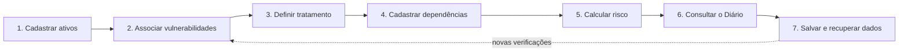
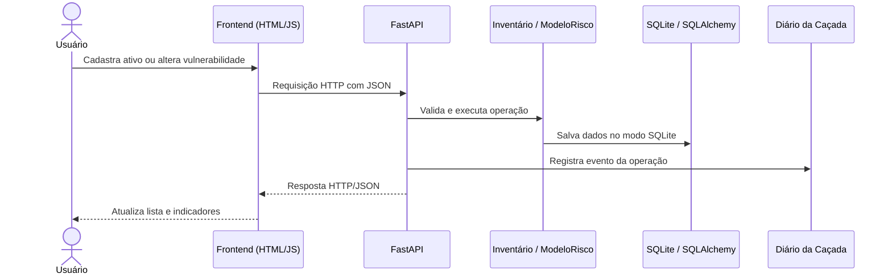
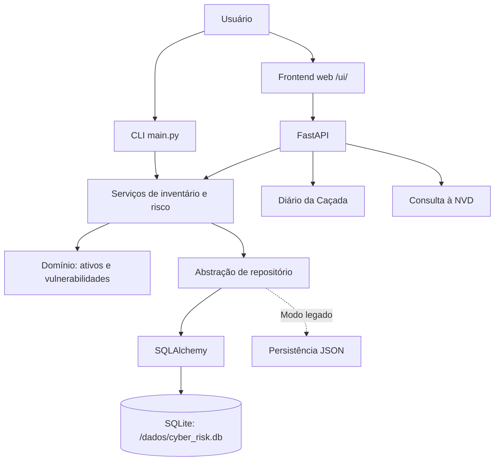

# Cyber Risk Engine — A Vigília

**Inventário de ativos de TI, gestão de vulnerabilidades e análise de risco com álgebra linear.**

Projeto acadêmico desenvolvido em Python no âmbito do **Trabalho 02 — Sprints 3, 4 e 5**, como evolução do inventário procedural do Trabalho 1. A aplicação reúne orientação a objetos, persistência por **SQLite com SQLAlchemy**, migrações com **Alembic**, suporte legado a JSON, integração com a **National Vulnerability Database (NVD)**, análise de risco por álgebra linear, uma API REST construída com **FastAPI**, interface web e execução por **Docker Compose** em ambiente local e em servidor Linux da faculdade.

A interface, chamada **A Vigília**, utiliza uma identidade visual inspirada na atmosfera de *Bloodborne*: os **ativos** são os recursos a proteger, as **vulnerabilidades** representam as “feras” identificadas e o **Diário da Caçada** registra as ações observadas pela API. A linguagem visual é temática; os cálculos e as regras de negócio são implementações técnicas independentes dessa analogia.

> **Estado documentado — 23/11/2026:** a aplicação foi implantada no servidor Linux da faculdade (`10.0.99.150`) com Docker e SQLite persistente. Em **18/11/2026, às 21h29min22s (UTC−3)**, o relatório de evidências registrou **24 horas e 18 minutos de execução do container**, `RestartCount=0`, estado `healthy` e HTTP `200` em `/health`, cumprindo o critério operacional de tempo de execução observado. O inventário migrado continha **6 ativos, 7 vulnerabilidades e 2 dependências**. Posteriormente, após alterar a publicação para `10.0.99.150:2202:8000`, foi relatado um teste de acesso à interface **a partir de outro computador da faculdade, sem túnel SSH**. Esse teste não equivale a monitoramento contínuo do endpoint e não confirma o estado do servidor em 23/11. A suíte automatizada teve **71 testes aprovados em container isolado com persistência JSON**; a persistência SQLite foi validada separadamente. **O projeto segue sendo protótipo acadêmico, sem login/autorização de usuários, e não deve receber dados sensíveis nem ser exposto fora do ambiente institucional sem proteção.**


<sub>Captura da interface na fase de validação local. Os números da imagem não necessariamente correspondem ao inventário restaurado no servidor durante a Sprint 5.</sub>

**Para começar:** leia [Como funciona](#comece-por-aqui-como-funciona-o-cyber-risk-engine), acompanhe a [demonstração curta](#demonstração-curta-roteiro-de-5-minutos) ou siga o [estudo de caso completo](#estudo-de-caso-uma-vulnerabilidade-do-cadastro-à-reavaliação).

## Sumário

- [Comece por aqui: como funciona o Cyber Risk Engine](#comece-por-aqui-como-funciona-o-cyber-risk-engine)
- [Visão geral e funcionalidades](#visão-geral-e-funcionalidades)
- [Guia de todas as telas da interface](#guia-de-todas-as-telas-da-interface)
- [Imagens reais da aplicação](#imagens-reais-da-aplicação)
- [Estudo de caso: uma vulnerabilidade do cadastro à reavaliação](#estudo-de-caso-uma-vulnerabilidade-do-cadastro-à-reavaliação)
- [Tecnologias](#tecnologias)
- [Arquitetura](#arquitetura)
- [Manual da interface CLI](#manual-da-interface-cli)
- [Instalação e execução local](#instalação-e-execução-local)
- [Execução com Docker](#execução-com-docker)
- [Implantação da Sprint 5 no servidor da faculdade](#implantação-da-sprint-5-no-servidor-da-faculdade)
- [Comprovação das 24 horas e evidências](#comprovação-das-24-horas-e-evidências)
- [Migração JSON → SQLite realizada no servidor](#migração-json-sqlite-realizada-no-servidor)
- [Modelo matemático de risco](#modelo-matemático-de-risco)
- [Limitações científicas e operacionais do modelo de risco](#limitações-científicas-e-operacionais-do-modelo-de-risco)
- [API REST](#api-rest)
- [Persistência e Diário da Caçada](#persistência-e-diário-da-caçada)
- [Testes automatizados](#testes-automatizados)
- [Estrutura do repositório](#estrutura-do-repositório)
- [Diagnóstico e solução de problemas](#diagnóstico-e-solução-de-problemas)
- [Perguntas frequentes](#perguntas-frequentes)
- [Glossário técnico](#glossário-técnico)
- [Limitações e próximos passos](#limitações-e-próximos-passos)
- [Preparação para a entrega e apresentação (novembro de 2026)](#preparação-para-a-entrega-e-apresentação-novembro-de-2026)
- [Identidade visual e uso de mídia](#identidade-visual-e-uso-de-mídia)

## Comece por aqui: como funciona o Cyber Risk Engine

Este é o ponto de partida recomendado para quem visita o repositório pela primeira vez. **Não é necessário entender Python, FastAPI ou álgebra linear para explorar a interface.** Primeiro, o usuário registra seus recursos de TI; depois, relaciona vulnerabilidades, descreve dependências e solicita o cálculo de risco. O backend executa as regras e devolve o resultado.

### A ideia do programa em uma frase

> **Inventariar o que deve ser protegido, identificar as falhas associadas, descrever como os ativos dependem uns dos outros, calcular a propagação do risco e acompanhar as alterações no Diário da Caçada.**

### O ciclo de funcionamento, do início ao fim



| Etapa | O que a pessoa faz | O que o programa faz |
|---|---|---|
| **1. Inventário** | Cadastra notebook, servidor, roteador ou aplicação web. | Valida os atributos e armazena um objeto do tipo correto. |
| **2. Vulnerabilidades** | Associa falhas aos ativos, manualmente ou a partir de uma pesquisa NVD. | Valida identificadores, descrição, categoria, severidade e estado de tratamento. |
| **3. Tratamento** | Marca uma falha como aberta, em tratamento, corrigida ou aceita. | Persiste o estado; falhas `CORRIGIDA` deixam de contribuir para o risco próprio calculado. |
| **4. Dependências** | Informa qual ativo depende de outro e qual é o nível de dependência. | Constrói vínculos direcionados com pesos definidos pelo modelo. |
| **5. Análise** | Abre **Análise de risco** e clica em **Recalcular**. | Monta matrizes, resolve o sistema linear e devolve as pontuações de risco. |
| **6. Histórico** | Abre **Diário da Caçada** e atualiza a lista. | Consulta eventos observados nas operações da API desde a ativação do diário. |
| **7. Persistência** | Reinicia a API ou recria o container sem apagar o volume. | No Docker validado, recupera o inventário do SQLite e mantém acessível o histórico de eventos persistido. |

**Atenção:** o Cyber Risk Engine **não faz varredura automática dos equipamentos**. A associação de uma vulnerabilidade a um ativo depende de uma decisão do usuário. A pesquisa de CVEs na NVD fornece referências públicas; ela não prova que o notebook ou servidor tenha realmente aquela falha.

### Qual interface devo utilizar?

O projeto oferece **duas formas de uso**:

- **Interface gráfica — “A Vigília” (`/ui/`):** indicada para explorar o sistema. Permite CRUD, consulta CVE, dependências, análise de risco, manual **Como funciona** e **Diário da Caçada**.
- **Interface de terminal — `python main.py`:** mantém os menus didáticos originais de ativos, vulnerabilidades e risco. Nem todas as operações extras da API estão expostas como opções diretas da CLI.

As duas reutilizam as classes de domínio e os serviços de negócio, mas **podem utilizar configurações de persistência diferentes**. O modo `sqlite` foi verificado na API do Docker; o README anterior documentava JSON para a CLI. Não suponha que a CLI e o frontend compartilham automaticamente o mesmo banco ou inventário.

### Início rápido: escolha seu ambiente

| Objetivo | Comando principal | Onde abrir | Inventário utilizado |
|---|---|---|---|
| **Docker local** | `docker compose up --build -d` (com porta publicada em `127.0.0.1:2202`) | `http://127.0.0.1:2202/ui/` | SQLite em `/dados/cyber_risk.db` no volume Docker local |
| **Servidor da faculdade** | Container já implantado; verificar com `sudo docker compose ps` | `http://10.0.99.150:2202/ui/` **na rede autorizada**, conforme teste relatado | SQLite no volume nomeado do servidor, separado do Windows |
| **Experimentar com Python local** | `python -m uvicorn api.app:app --host 127.0.0.1 --port 8001` | `http://127.0.0.1:8001/ui/` | Depende do modo de persistência e das variáveis configuradas antes da inicialização |
| **Usar o terminal** | `python main.py` | O próprio PowerShell | Repositório JSON descrito na implementação original da CLI |

Se você ainda não configurou Python e Docker, vá às seções [Instalação e execução local](#instalação-e-execução-local) ou [Execução com Docker](#execução-com-docker). Em seguida, volte para o tutorial abaixo.

### Tutorial guiado: primeira caçada completa

Os IDs e nomes seguintes são **somente exemplos didáticos**. Use identificadores ainda não cadastrados na sua instalação e **prefira um inventário de teste**, pois operações como exclusão e mudança de status alteram dados persistentes.

#### Passo 1 — Abrir o inventário

Acesse `http://127.0.0.1:2202/ui/` se estiver utilizando Docker, ou `http://127.0.0.1:8001/ui/` se estiver utilizando Uvicorn local. Na página inicial, você verá o painel **Vigília dos Ativos**, com indicadores de ativos e vulnerabilidades. Um inventário vazio no primeiro uso **é normal**; não significa que a aplicação falhou.

#### Passo 2 — Cadastrar o primeiro ativo

Selecione **Inventário de ativos → + Cadastrar** e use os seguintes valores como referência:

| Campo | Exemplo |
|---|---|
| ID | `9701` |
| Nome | `Notebook Laboratório` |
| Responsável | `Equipe TI` |
| Setor | `Laboratório` |
| Tipo | `Notebook` |
| Processador | `Intel Core i5` |

Ao escolher `Notebook`, a interface solicita o campo específico `processador`. Se você escolher `Servidor`, esse campo é substituído pelo serviço; `Roteador` pede endereço IP; `AplicacaoWeb` pede URL.

**Resultado esperado:** o ativo passa a aparecer na lista. Ao clicar nele, a coluna **Detalhes do ativo** mostra seus atributos, com ações para **Editar**, **Excluir**, **Vulnerabilidades** e **Dependências**.

#### Passo 3 — Cadastrar um segundo ativo

Cadastre outro registro para representar uma dependência técnica:

| Campo | Exemplo |
|---|---|
| ID | `9702` |
| Nome | `Servidor de Serviços` |
| Responsável | `Equipe TI` |
| Setor | `Infraestrutura` |
| Tipo | `Servidor` |
| Serviço | `Serviço de autenticação` |

Agora há dois recursos que podem trocar risco por meio de uma relação direcionada.

#### Passo 4 — Associar uma vulnerabilidade de exemplo

Abra **Vulnerabilidades → + Associar vulnerabilidade**. Selecione o servidor `9702` e preencha:

| Campo | Exemplo |
|---|---|
| ID interno | `9711` |
| Descrição | `Falha de exemplo para demonstração do modelo` |
| Categoria / CWE | `CWE-79` — apenas como categoria ilustrativa |
| Severidade CVSS | `7.1` |
| Tratamento | `ABERTO` |

Os campos CVE, CWE estruturado, versão CVSS e vetor CVSS podem ser preenchidos quando existirem dados confiáveis. **Não invente uma CVE real para um equipamento real** apenas para completar o formulário.

**Resultado esperado:** a vulnerabilidade aparece vinculada ao servidor; sua severidade passa a integrar o cálculo do risco próprio enquanto seu status não for `CORRIGIDA`.

#### Passo 5 — Experimentar a pesquisa NVD (opcional)

Abra **Consulta CVE / NVD**, pesquise `XSS`, `SQL Injection` ou outro termo técnico e analise os resultados retornados pela NVD. Você poderá escolher uma referência para auxiliar a associação a um ativo. A pesquisa depende de internet, da disponibilidade da NVD e da janela temporal configurada no backend. **Não é um scanner de vulnerabilidades nem uma confirmação de exploração.**

#### Passo 6 — Estabelecer uma dependência

Abra **Dependências → + Criar vínculo** e informe:

- **Ativo dependente / destino:** Notebook `9701`.
- **Origem do risco:** Servidor `9702`.
- **Nível:** `MODERADA`.

Essa direção é importante: **o Notebook recebe parte do risco do Servidor**, e não o contrário. No modelo atual, `MODERADA` equivale a peso `0,25`. Assim, o risco efetivo do Notebook poderá aumentar, mesmo que ele não possua vulnerabilidades próprias.

#### Passo 7 — Calcular o risco

Abra **Análise de risco → Recalcular**. O sistema apresenta risco próprio, risco efetivo, comparação visual e número de condição da matriz. Expanda **Inspecionar matrizes M, v, b, A, I − A e x** para visualizar as estruturas matemáticas usadas no cálculo.

**Resultado esperado para o exemplo simplificado:** com apenas o Servidor possuindo severidade `7,1` e o Notebook dependendo dele com peso `0,25`, o risco próprio do Notebook é `0` e o risco efetivo herdado é `1,775` (se não houver outras relações). O resultado é uma **pontuação do modelo**, não um CVSS do notebook.

#### Passo 8 — Registrar a evolução do tratamento

Volte a **Vulnerabilidades**, localize a falha no Servidor e altere seu estado de `ABERTO` para `EM_TRATAMENTO`. Após a validação da correção **em um cenário real**, o operador pode marcar `CORRIGIDA`; neste tutorial, a mudança é apenas uma simulação.

Ao recalcular, a falha corrigida deixa de contribuir para o risco próprio e o risco herdado pode diminuir. Em uma aplicação real, **a marcação de `CORRIGIDA` deve ocorrer somente após verificação técnica independente**.

#### Passo 9 — Consultar o Diário da Caçada

Abra **Diário da Caçada → Atualizar diário**. O sistema lista eventos HTTP observados: cadastro de ativos, associação de vulnerabilidades, alterações de tratamento, alterações de atributos e vínculos, entre outros. O arquivo histórico é separado do inventário.

Os nomes “fera identificada”, “em caçada” e “abatida” fazem parte da metáfora visual. **Não equivalem a uma análise pericial, correção comprovada ou atestado de conformidade**.

#### Passo 10 — Entender persistência e reinicialização

Para testar no Docker, **não use `down -v`**. Recrie o container sem remover o volume:

```powershell
docker compose down
docker compose up -d
docker compose ps
```

Retorne ao inventário e ao diário. No ambiente SQLite validado, o arquivo `/dados/cyber_risk.db` foi preservado no volume e os registros da API continuaram acessíveis após a recriação. Essa prova de persistência é **diferente de provar 24 horas ininterruptas de disponibilidade**.

#### Passo 11 — Conferir API e Swagger

Abra `/docs` na mesma porta da aplicação. A documentação interativa mostra as rotas HTTP e permite experimentar consultas, como `GET /ativos` e `GET /risco`. **Evite clicar em “Execute” em rotas de alteração usando o inventário principal**, pois elas persistem dados.

#### Passo 12 — Continuar explorando

Teste busca de ativos, edição de atributos específicos, listagem filtrada de vulnerabilidades, remoção de vínculos e visualização das matrizes. O **Como funciona** dentro da interface oferece explicações resumidas; **este README é o manual de uso e referência técnica aprofundada**.

### Demonstração curta — roteiro de 5 minutos

Este roteiro foi planejado para uma apresentação acadêmica, entrevista técnica ou vídeo breve de portfólio. **Faça a demonstração em um inventário de teste ou no volume local do Docker**, não no arquivo principal sem backup. Prepare os IDs `9701`, `9702` e `9711`, ou use IDs ainda livres.

| Tempo sugerido | Ação na tela | Explicação para quem está assistindo | Evidência visível |
|---|---|---|---|
| 0:00–0:40 | Mostrar a **Vigília dos Ativos** e cadastrar um notebook. | "O sistema mantém um inventário orientado a objetos, com atributos específicos por tipo." | O novo ativo aparece na lista e no painel de detalhes. |
| 0:40–1:30 | Cadastrar um servidor e associar a ele uma falha demonstrativa de severidade `7,1` com status `ABERTO`. | "O CVSS é uma entrada de severidade; ele não confirma exploração nem representa, sozinho, o risco de negócio." | Vulnerabilidade exibida no servidor. |
| 1:30–2:10 | Criar dependência do notebook para o servidor com nível `MODERADA`. | "A direção é importante: o notebook recebe parte da pontuação do servidor." | Vínculo cadastrado. |
| 2:10–3:10 | Abrir **Análise de risco**, recalcular e expandir as matrizes. | "O risco próprio é `b=Mv`; o risco efetivo é a solução de `(I-A)x=b`." | Notebook com risco próprio `0` e efetivo `1,775`, servidor com `7,1`, no cenário isolado. |
| 3:10–4:05 | Alterar a falha para `EM_TRATAMENTO`, depois `CORRIGIDA` **como simulação**. | "Em tratamento não reduz automaticamente a pontuação. Marcada como corrigida, a falha é desconsiderada pelo modelo; isso não comprova remediação real." | Mudança de tratamento e novo cálculo. |
| 4:05–5:00 | Mostrar o Diário e, se útil, o Docker. | "O histórico registra alterações observadas pela API, e o volume preserva inventário e diário após recriação do container." | Eventos datados e container `healthy`. |

**Fala de encerramento sugerida:** "O Cyber Risk Engine conecta inventário, referências de vulnerabilidade, tratamento, dependências e álgebra linear em uma aplicação Python com API, frontend e persistência Docker. A pontuação é acadêmica e apresenta limitações explicitadas no README."

**Alternativa para 2 minutos:** apresente um ativo já cadastrado, mostre a vulnerabilidade, execute o cálculo, altere somente o tratamento e compare o resultado. Não há necessidade de realizar exclusões durante a demonstração.

### Como as partes conversam entre si?



**Resumo prático:** JavaScript apresenta as telas e envia requisições. Python executa regras e cálculos. No Docker testado, a persistência do inventário utiliza SQLite, acessado por uma camada SQLAlchemy, e o Diário da Caçada continua acessível após recriar o container. **O formato de armazenamento interno do Diário deve ser confirmado no código atual antes de afirmá-lo como tabela SQL ou arquivo JSONL.**

### O que o programa faz — e o que não faz

| Realiza | Não realiza automaticamente |
|---|---|
| Mantém inventário de ativos e vulnerabilidades informadas. | Descoberta de dispositivos na rede ou varredura automática de portas. |
| Consulta referências públicas da NVD por termo. | Confirmação de que uma CVE afeta um equipamento específico. |
| Calcula pontuações próprias e propagadas por dependência. | Estimativa probabilística de incidentes ou prejuízo financeiro. |
| Registra alterações vistas pela API no Diário. | Prova imutável de auditoria, autoria ou remediação. |
| Persiste o inventário em SQLite no Docker e preserva o volume entre recriações. | Garantia de operação multiusuário, alta disponibilidade ou transações distribuídas. |
| Executa em Docker local e no servidor acadêmico e responde a `/health`. | Garantia de disponibilidade HTTP ininterrupta, alta disponibilidade ou serviço de produção. |

## Visão geral e funcionalidades

O Cyber Risk Engine permite cadastrar ativos de TI, associar vulnerabilidades, definir dependências entre ativos e calcular como a exposição de um componente pode influenciar os demais. O objetivo é transformar um inventário CRUD em um exercício integrado de **engenharia de software e análise de risco**.

| Módulo | Funcionalidades implementadas |
|---|---|
| **Ativos** | Cadastro, listagem, busca, consulta, atualização e exclusão de ativos; validação de campos e atributos específicos por tipo. |
| **Vulnerabilidades** | Associação a ativos, consulta, atualização de descrição/categoria/severidade/tratamento e remoção pela API web. |
| **CVE / NVD** | Pesquisa por termo na API oficial da NVD e obtenção de informações de CVE, CWE e CVSS quando disponíveis. |
| **Dependências** | Cadastro, visualização e remoção de relações que propagam risco entre ativos. |
| **Análise de risco** | Matrizes de incidência e dependência, risco próprio e risco efetivo, com inspeção dos resultados matemáticos. |
| **Diário da Caçada** | Histórico persistente de mudanças observadas em operações HTTP bem-sucedidas, incluindo atualizações de tratamento e atributos. |
| **Como funciona** | Seção explicativa na interface web para orientar a utilização dos módulos. |
| **Interfaces** | Menu interativo no terminal e frontend responsivo em HTML, CSS e JavaScript. |

### Tipos de ativos

Os ativos são modelados por uma classe abstrata `Ativo` e subclasses com atributos próprios:

| Tipo | Classe Python | Atributo específico |
|---|---|---|
| Notebook | `Notebook` | `processador` |
| Servidor | `Servidor` | `servico` |
| Roteador | `Roteador` | `endereco_ip` |
| Aplicação web | `AplicacaoWeb` | `url` |

Cada registro também possui **ID, nome, responsável, setor, vulnerabilidades e dependências**. A aplicação aplica validações de domínio antes de aceitar valores, por exemplo IDs positivos, IP válido para roteadores e URL HTTP(S) válida para aplicações web.

### Tratamento das vulnerabilidades

O enum `Tratamento` utiliza quatro estados:

| Estado | Significado operacional |
|---|---|
| `ABERTO` | Vulnerabilidade registrada e ainda não corrigida. |
| `EM_TRATAMENTO` | Correção ou mitigação em andamento. |
| `CORRIGIDA` | Marcada como corrigida no inventário; desconsiderada no risco próprio do modelo. |
| `ACEITA` | Risco aceito conforme decisão registrada; não equivale a uma correção. |

**Importante:** `CORRIGIDA` indica um **status informado ao sistema**, e não uma comprovação técnica independente de remediação. A classificação CVSS original permanece armazenada mesmo quando a severidade efetiva considerada pelo modelo é zero.

## Guia de todas as telas da interface

A interface **A Vigília** reúne os módulos na barra lateral esquerda. Ao clicar em uma seção, o frontend muda a visualização sem exigir navegação para outro site. As operações que modificam dados são enviadas para a API REST e recebem confirmação ou mensagem de erro.

### 1. Inventário de ativos — Vigília dos Ativos

**Objetivo:** cadastrar e consultar os recursos tecnológicos que serão avaliados. A tela possui quatro indicadores: quantidade de ativos monitorados, vulnerabilidades abertas, em tratamento e corrigidas. Também oferece uma busca por **nome, ID, tipo, setor ou responsável**.

**Operações disponíveis:**

1. **Cadastrar:** clique em `+ Cadastrar`, escolha uma classe de ativo e preencha os campos exigidos.
2. **Consultar:** selecione uma linha da lista para abrir os detalhes completos à direita.
3. **Editar:** use o botão `Editar` do ativo selecionado; o campo específico muda conforme seu tipo.
4. **Excluir:** use `Excluir`, confirme a ação e verifique a remoção da lista e da API.
5. **Navegar para vulnerabilidades:** o botão do ativo selecionado abre a área relacionada às falhas associadas.
6. **Navegar para dependências:** o botão correspondente facilita analisar os vínculos desse ativo.
7. **Sincronizar:** recarrega as informações mais recentes da API para a interface.

A exclusão de um ativo também é tratada pelos serviços de inventário para evitar manter vínculos de dependência apontando para um ativo inexistente. **Como a alteração é persistente, faça backup antes de excluir registros relevantes.**

### 2. Vulnerabilidades — registro e tratamento das falhas

**Objetivo:** manter as falhas que o operador decidiu associar aos ativos. A tela possui filtros por **ativo** e **status de tratamento**, além de formulário para cadastro/edição e ações de remoção.

**Campos essenciais:** ID interno, descrição, categoria, severidade entre 0 e 10 e tratamento. **Campos de referência opcionais no cadastro:** `cve_id`, `cwe_id`, `cvss_vector` e `cvss_version`.

**Fluxo de trabalho:** associe a falha a um ativo → confira sua severidade → altere o tratamento conforme o andamento da remediação → recalcule o risco → verifique o evento no Diário.

Ao editar, a rota HTTP atual aceita **descrição, categoria, severidade e status**; os campos de metadados CVE/CWE/vetor/versão são cadastráveis, mas **não estão expostos como campos editáveis por essa rota**. Portanto, não prometa edição de todos os metadados após o cadastro sem uma implementação adicional.

Quando a mesma CVE é compartilhada por mais de um registro, existem validações de consistência, inclusive de severidade, para não associar pontuações conflitantes à mesma referência.

### 3. Dependências — quem recebe o risco de quem?

**Objetivo:** representar relações de dependência entre ativos, que alteram a propagação de risco no modelo matemático.

O formulário solicita um **ativo destino/dependente**, um **ativo origem** e um **nível**. A interface exibe vínculos, níveis e pesos; permite **criar** e **remover** relações. A configuração atual não possui uma rota dedicada de `PUT`/`PATCH` para editar diretamente uma dependência já existente; pela interface, a alternativa é excluir e cadastrar novamente.

**Exemplo de direção:** se o Notebook A depende do Servidor B, o Notebook A é o destino que recebe risco e o Servidor B é a origem que o transmite. Não confunda a direção com tráfego de rede: trata-se de uma relação de influência **definida pelo modelo**.

**Regra importante:** a classe de domínio impede que a soma dos pesos das dependências de um ativo alcance `1` ou mais, reduzindo o risco de relacionamentos instáveis. Outros cenários também são validados nos serviços.

### 4. Análise de risco — interpretação da tela

Essa tela é uma apresentação dos resultados produzidos por `ModeloRisco`, não um cálculo independente em JavaScript. A tabela contém:

| Coluna | Significado |
|---|---|
| **Ativo** | Identificação do objeto analisado. |
| **Risco próprio** | Soma das severidades não corrigidas associadas ao ativo, segundo `b = Mv`. |
| **Risco efetivo** | Pontuação que incorpora a influência das dependências, obtida por `(I-A)x = b`. |
| **Comparação** | Barra visual para facilitar a comparação entre pontuações. |
| **Número de condição** | Indicador matemático da sensibilidade do sistema linear. |
| **Inspecionar matrizes** | Expõe `M`, `v`, `b`, `A`, `I-A` e `x`. |

O valor **pode ultrapassar 10**. Isso não significa que a fórmula CVSS foi alterada: o programa calcula uma **pontuação agregada acadêmica**, enquanto CVSS descreve severidade de vulnerabilidades individuais.

### 5. Consulta CVE/NVD — dados públicos de vulnerabilidades

**Objetivo:** pesquisar, por palavra-chave, registros publicados na **National Vulnerability Database**.

Digite um termo como `XSS` ou `SQL Injection` e clique em **Pesquisar**. Se houver resultados compatíveis com a consulta e a janela temporal, a interface apresenta identificador CVE, descrição, CWE e pontuação CVSS quando disponível. A opção de associação ajuda a transferir as informações para o cadastro de vulnerabilidade de um ativo escolhido.

**Limitações:** a NVD pode estar indisponível; o programa não pesquisa automaticamente o passado completo, não cruza versões instaladas com versões afetadas e não garante que o ativo esteja vulnerável.

### 6. Como funciona — o Códice do Caçador

Essa é a área de apoio dentro do próprio aplicativo. Ela contém tópicos expansíveis sobre:

1. Inventário e atributos dos ativos.
2. Vulnerabilidades, severidade e tratamento.
3. CVE, CWE, CVSS e NVD.
4. Dependências e direção da propagação.
5. Álgebra linear e risco efetivo.
6. Comunicação frontend/API e persistência.
7. Diário da Caçada e diferença entre histórico e monitoramento Docker.

O Códice é uma **introdução de uso**. O README amplia esses tópicos com comandos, exemplos HTTP, equações, validações e orientações de segurança.

### 7. Diário da Caçada — cronologia das alterações

A página exibe contadores de **registros**, **em caçada** e **abatidas**, filtros por categoria de evento e a lista cronológica dos acontecimentos mais recentes. O botão **Atualizar diário** consulta novamente a API.

- **Registro:** uma alteração observada em operação HTTP bem-sucedida; não é necessariamente um ativo novo.
- **Em caçada:** quantidade de eventos em que uma vulnerabilidade recebeu o estado `EM_TRATAMENTO`.
- **Abatidas:** quantidade de eventos de transição que culminaram em `CORRIGIDA`.

Os indicadores são contagens **de eventos históricos**, não o estoque atual de vulnerabilidades no inventário. O histórico contém data e hora e pode mostrar os campos que mudaram antes/depois, quando detectados. Ele só acompanha operações que passam pela API observada.

### 8. Player de música — recurso opcional e local

O botão **Ativar trilha** controla um elemento `<audio>` do navegador. O arquivo procurado é `frontend/assets/audio/laurence.mp3`, que **não acompanha a distribuição pública nem a imagem Docker**. O navegador pode impedir reprodução automática até ocorrer interação do usuário. Sem o MP3 disponível no caminho esperado, a interface continua utilizável, mas a música não toca.

Para o Docker, copiar o arquivo diretamente para a camada gravável de um container é uma solução **temporária**: ao recriar o container, essa cópia pode desaparecer, mesmo que o volume de dados `/dados` seja preservado. Verifique direitos de uso antes de disponibilizar qualquer gravação.

## Imagens reais da aplicação

As imagens abaixo são **capturas do projeto efetivamente executado**, fornecidas durante os testes da Sprint 4. Não são ilustrações conceituais nem telas simuladas. Os valores correspondem a estados específicos de inventários demonstrativos e podem variar após novas operações.

### Inventário — visão geral


O inventário reúne busca por nome/ID/tipo/setor/responsável, indicadores de tratamento e um painel de inspeção com as ações de edição, exclusão, vulnerabilidades e dependências.

### Inspeção de uma vulnerabilidade associada


A inspeção mostra o vínculo entre o ativo e a falha associada. Na captura de demonstração, os detalhes incluem identificador CVE, severidade e status. Uma CVE associada **não comprova automaticamente que a versão instalada do software está vulnerável**.

### Análise de risco — comparação entre risco próprio e efetivo


Exemplo com seis ativos e comparação lado a lado. O Roteador Principal aparece com risco próprio zero e risco efetivo positivo devido à propagação de uma dependência. A soma de severidades pode ultrapassar 10; portanto, **a coluna de risco efetivo não é uma nota CVSS**.

### Diário da Caçada — eventos em ordem cronológica


A captura mostra cadastro, associação e duas transições `ABERTO → EM_TRATAMENTO → CORRIGIDA`. Os números **Em caçada** e **Abatidas** derivam de transições registradas; não são um scanner de ameaças nem prova de que o conserto foi tecnicamente auditado.

### Container Docker — execução local


A aplicação é empacotada em uma imagem Docker Linux e iniciada com Docker Compose. Em desenvolvimento local, a porta de host ajustada é `2202`, encaminhada à porta `8000` interna do container. A imagem desta seção é da fase local; a **implantação no servidor, o acesso remoto e as 24 horas** são documentados em seção específica, com evidências de novembro de 2026.

> **Manutenção das capturas:** os arquivos de imagem ficam em `docs/imagens/`. Para atualizar uma captura no futuro, utilize o mesmo nome do arquivo e faça commit da nova imagem; não é necessário reescrever os links do README. Evite capturar dados pessoais reais, endereços privados, tokens e senhas.

## Estudo de caso: uma vulnerabilidade do cadastro à reavaliação

Esta seção demonstra o uso completo do Cyber Risk Engine com valores reproduzíveis. **O cenário é fictício e serve apenas para ensino e validação do software.** Não representa um equipamento comprovadamente vulnerável, um incidente real ou um laudo de remediação.

### Cenário e hipótese

Uma equipe administra um notebook que depende de um serviço central para autenticação. O servidor tem uma vulnerabilidade ilustrativa cuja severidade registrada é `7,1`. Deseja-se entender se o notebook pode receber risco mesmo sem vulnerabilidades próprias, e como o tratamento da vulnerabilidade do servidor altera o resultado do modelo.

| Elemento | Valor de demonstração | Interpretação |
|---|---|---|
| Ativo 1 | Notebook `9701` — `Notebook Laboratório` | Recurso que **recebe** risco pela dependência. |
| Ativo 2 | Servidor `9702` — `Servidor de Serviços` | Recurso que **transmite** risco ao notebook. |
| Vulnerabilidade | ID interno `9711`, severidade `7,1`, status `ABERTO` | Registro ilustrativo associado **somente ao servidor**. |
| Categoria | `CWE-79` | Rótulo demonstrativo de fraqueza, sem afirmar que existe XSS no servidor real. |
| Dependência | `9701` recebe risco de `9702` | Direção correta para construir `A`. |
| Nível | `MODERADA` = peso `0,25` | Parâmetro definido pelo projeto, não probabilidade real. |

### Etapa A — Cadastrar os ativos

Pela interface, use **Inventário de ativos → + Cadastrar** duas vezes. Selecione `Notebook` para o primeiro registro e `Servidor` para o segundo. Os dois passam a existir como instâncias concretas do domínio (`Notebook` e `Servidor`) e podem ser consultados e editados independentemente.

**Verificação:** abra `/ativos` ou pesquise ambos os IDs no inventário. Um identificador repetido é rejeitado para evitar duplicidade de ativos.

### Etapa B — Identificar, classificar e associar a falha

Selecione o servidor e associe uma vulnerabilidade com severidade nominal `7,1`. Se essa nota fosse uma pontuação **CVSS v3.x real**, ela estaria na faixa usual de severidade **alta** (7,0 a 8,9). Aqui, entretanto, o número é **um dado demonstrativo**; a categoria CWE, a descrição e o valor devem ser validados antes de qualquer uso operacional.

A busca na NVD por um termo como `XSS` pode fornecer CVEs públicos, descrições, CWEs e escores disponíveis. **Não selecione automaticamente um CVE para um ativo apenas porque o termo coincide**: confirme fabricante, produto, versões afetadas e contexto da instalação por procedimentos externos.

### Etapa C — Calcular o risco próprio sem dependência

Com a falha associada apenas ao servidor, o vetor de severidades contém `v = [7,1]`. A matriz de incidência `M`, nas linhas `[Notebook, Servidor]`, é:

```text
M = [[0],
     [1]]

v = [7,1]

b = Mv = [0,0; 7,1]
```

O notebook tem **risco próprio zero** porque não recebeu vulnerabilidade ativa nesse inventário; o servidor tem **risco próprio 7,1**.

### Etapa D — Criar a dependência e construir `A`

Adicione a dependência com destino notebook `9701`, origem servidor `9702` e nível `MODERADA`. O peso é `0,25`. A matriz `A` passa a ser:

$$
A = \begin{bmatrix}
0 & 0{,}25\\
0 & 0
\end{bmatrix}
\quad\text{e}\quad
I-A = \begin{bmatrix}
1 & -0{,}25\\
0 & 1
\end{bmatrix}.
$$

A linha do notebook contém o coeficiente relativo ao servidor porque a influência vai **da origem para o destino**. Sem outras dependências, o sistema a resolver é:

$$
\begin{cases}
x_{\text{notebook}} - 0{,}25x_{\text{servidor}} = 0 \\
x_{\text{servidor}} = 7{,}1
\end{cases}
$$

Logo:

$$
x_{\text{servidor}} = 7{,}1,
\qquad
x_{\text{notebook}} = 0{,}25\times 7{,}1 = 1{,}775.
$$

### Etapa E — Interpretar o resultado na interface

| Ativo | Risco próprio `b` | Risco efetivo `x` | Explicação |
|---|---:|---:|---|
| Notebook `9701` | `0` | **`1,775`** | Herda parcela da pontuação do servidor. |
| Servidor `9702` | **`7,1`** | **`7,1`** | Possui vulnerabilidade própria; não herda risco nesse cenário. |

Esse resultado é uma **pontuação matemática agregada**, não a probabilidade de exploração, nem uma classificação quantitativa calibrada de impacto em reais. A severidade CVSS nominal pertence à falha; o risco efetivo pertence ao modelo de relações entre ativos.

### Etapa F — Aplicar tratamento e recalcular

1. Atualize o tratamento para `EM_TRATAMENTO` e recalcule. **A pontuação permanece 7,1 para o servidor e 1,775 para o notebook**, pois o código não aplica redução proporcional nesse estado.
2. **Após verificar a correção em um ambiente real**, marque `CORRIGIDA`. Para o estudo de caso, a operação é simulada e não representa verificação técnica.
3. Recalcule. O modelo desconsiderará a contribuição da falha corrigida em `M`, deixando `b = [0; 0]` e, no cenário isolado, `x = [0; 0]`.
4. Abra **Diário da Caçada**. O sistema deve registrar as transições efetuadas pela API e os horários correspondentes. Ele não reconstrói automaticamente eventos anteriores à sua ativação.

**Comparativo temporal:**

| Etapa | Estado da falha | Risco próprio do servidor | Risco efetivo do notebook |
|---|---|---:|---:|
| Cadastro | `ABERTO` | `7,1` | `1,775` |
| Tratamento iniciado | `EM_TRATAMENTO` | `7,1` | `1,775` |
| Correção registrada | `CORRIGIDA` | `0` | `0` |

O resultado `0` após a correção é consequência da regra binária do modelo. Ele **não é evidência de risco zero no mundo real**.

### Etapa G — Verificar persistência do inventário e do Diário

No Docker atual, o inventário está armazenado em SQLite (`/dados/cyber_risk.db`); o histórico também permaneceu acessível após a recriação do container, embora o mecanismo interno do Diário precise ser conferido no código atual. Um teste seguro de recriação consiste em:

```powershell
docker compose down
docker compose up -d
docker compose ps
```

Reabra `/ui/`, confirme os registros e consulte `/diario`. Esse procedimento preservou os registros no teste de 12/11/2026. O conteúdo do SQLite no volume Docker não altera automaticamente o `ativos.json` no Windows.

### Etapa H — O que esse caso comprova e o que não comprova?

**Comprova no cenário:** cadastro orientado a objetos, associação e tratamento de vulnerabilidade, criação de dependência, cálculo `b=Mv`, propagação por `(I-A)x=b`, atualização de resultados e armazenamento das operações.

**Não comprova:** exploração real da vulnerabilidade, certeza de remediação, medição probabilística de risco, decisão formal de aceitação de risco, autoria inviolável do Diário ou disponibilidade contínua por 24 horas.

## Tecnologias

- **Python** — domínio, serviços, persistência, API e interface CLI.
- **NumPy** — criação de matrizes, operações vetoriais e resolução do sistema linear.
- **FastAPI + Pydantic + Uvicorn** — API HTTP, validação de entrada e servidor ASGI.
- **Requests** — consulta à API pública da NVD.
- **HTML, CSS e JavaScript** — interface web, formulários e consumo assíncrono da API.
- **SQLite + SQLAlchemy** — armazenamento relacional utilizado no ambiente Docker validado para o inventário.
- **JSON** — formato das respostas HTTP e alternativa histórica de persistência documentada para a CLI.
- **Diário da Caçada** — histórico de mudanças acessível pela API; em `/dados` foi observado o arquivo `ativos_diario.jsonl` (JSONL) no servidor, preservado no volume Docker.
- **Pytest + HTTPX / TestClient** — testes automatizados do domínio, API e módulos web.
- **Docker e Docker Compose** — execução isolada e persistência em volume nomeado.
- **Git e GitHub** — versionamento e trabalho por branches.

As dependências Python estão relacionadas em [`requirements.txt`](requirements.txt). O Dockerfile da versão validada utiliza `python:3.14-slim`; a execução local requer uma versão de Python compatível com as dependências do projeto.

## Arquitetura

A organização em camadas separa a interface, as regras de negócio e a infraestrutura. A API expõe os serviços do domínio e, **no ambiente Docker verificado**, utiliza SQLite com SQLAlchemy para armazenar o inventário. O modo JSON continua citado como implementação histórica da CLI; a compatibilidade exata entre os modos deve ser confirmada nos módulos atuais.



**Responsabilidades principais:**

- `dominio/`: ativos, vulnerabilidades, enums e validações.
- `servicos/`: CRUD, regras do inventário, relações entre ativos e análise de risco.
- `infraestrutura/`: adaptações de persistência. O README anterior descrevia implementações JSON e em memória; o modo SQLite/SQLAlchemy foi verificado operacionalmente, mas os **nomes exatos dos novos arquivos/classes ORM não constam dos anexos**.
- `api/`: endpoints HTTP, integração com o frontend e registro de eventos.
- `interface/cli/`: menus e interação via terminal.
- `frontend/`: interface visual e consumo da API.
- `tests/`: verificações automatizadas.

### Contratos entre as camadas

| Camada | Responsabilidade | Evidência ou observação |
|---|---|---|
| Frontend | Enviar requisições e apresentar dados. | Interface `/ui/` documentada e utilizada nos testes anteriores. |
| API REST | Validar entrada e atender rotas HTTP. | `GET`, `POST`, `PUT`, `PATCH` e `DELETE` exercitados na API atual. |
| Serviços e domínio | Aplicar regras de negócio e calcular risco. | Modelos de ativos, vulnerabilidades e dependências descritos neste README. |
| Persistência SQL | Guardar dados estruturados e recuperá-los. | `CYBER_RISK_STORAGE=sqlite` e tabela `ativos` consultada em `/dados/cyber_risk.db`. |
| Diário | Expor histórico das alterações observadas pela API. | Eventos recuperados via `GET /diario` antes e depois de recriar container. |
| Docker Compose | Iniciar serviço e manter dados fora da camada descartável do container. | `docker compose down` + `up -d` preservaram o inventário. |

### SQLAlchemy e SQLite: papéis distintos

**SQLite** é o mecanismo de banco de dados relacional que guarda as informações em um arquivo. **SQLAlchemy** é a biblioteca Python usada pela camada de persistência para acessar o banco. Não são a mesma tecnologia. Os testes de 12/11 confirmaram a tabela `ativos` e a leitura de sete registros no ambiente local; **o servidor recebeu posteriormente um inventário migrado de seis ativos** e manteve a persistência em um volume Docker nomeado.

A implantação atual não deve ser descrita como servidor SQL centralizado: **SQLite funciona embutido na aplicação** e depende da preservação e dos backups do arquivo no volume. Vários navegadores podem usar a API ao mesmo tempo, mas isso não equivale a comprovar controle de concorrência ou capacidade multiusuário em produção.

### Programação orientada a objetos e padrões

- **Abstração, herança e polimorfismo:** `Ativo` é a classe base, especializada em `Notebook`, `Servidor`, `Roteador` e `AplicacaoWeb`.
- **Factory:** centraliza a criação/reconstrução de objetos conforme o tipo do ativo.
- **Repository:** separa serviços das implementações concretas de armazenamento; a interface de persistência é parte importante para testar e alternar implementações.
- **Injeção de dependência:** serviços recebem colaboradores para reduzir acoplamento.
- **Strategy:** estratégias de ordenação permitem variar a listagem.

O padrão Singleton foi estudado, mas não é um requisito para o inventário.

## Manual da interface CLI

O programa original pode ser executado com `python main.py` na raiz do repositório. A implementação documentada anteriormente utiliza repositório JSON na CLI. **A alteração validada para SQLite refere-se à API no Docker; não se comprovou, pelos arquivos enviados, que a CLI já tenha passado a utilizar SQLAlchemy.**

### Menu principal

```text
===== CYBER RISK ENGINE =====
1 - Gerenciar ativos
2 - Gerenciar vulnerabilidades
3 - Análise de risco
0 - Sair
```

A CLI permanece útil para demonstrações dos conceitos de POO, entrada validada, fluxos condicionais e operações do domínio sem navegador.

### Gerenciar ativos (`interface/cli/menu_ativos.py`)

| Opção | Comportamento |
|---|---|
| `1 - Cadastrar ativo` | Solicita ID positivo, nome, responsável, setor, tipo e atributo específico. |
| `2 - Listar ativos` | Apresenta os recursos cadastrados. |
| `3 - Consultar ativo` | Localiza um ativo por ID e mostra seus atributos. |
| `4 - Atualizar ativo` | Permite atualizar campos comuns e o atributo correspondente à subclasse. |
| `5 - Remover ativo` | Solicita o ID e aplica a remoção via inventário. |
| `0 - Voltar` | Retorna ao menu principal. |

### Gerenciar vulnerabilidades (`interface/cli/menu_vulnerabilidades.py`)

| Opção | Comportamento |
|---|---|
| `1 - Cadastrar vulnerabilidade` | Permite cadastro manual ou pesquisa NVD por termo, depois associação a um ativo. |
| `2 - Listar vulnerabilidades` | Exibe as vulnerabilidades de um ativo informado. |
| `3 - Atualizar vulnerabilidade` | Altera os campos disponíveis, inclusive tratamento. |
| `0 - Voltar` | Retorna ao menu principal. |

A **remoção de vulnerabilidade pela API/web** é uma funcionalidade adicional e não aparece como opção direta nesse menu CLI.

### Análise de risco (`interface/cli/menu_risco.py`)

| Opção | Comportamento |
|---|---|
| `1 - Cadastrar dependência` | Pede ID do ativo destino, ID de origem e nível de dependência. |
| `2 - Listar dependências` | Consulta as dependências de um ativo. |
| `3 - Calcular risco` | Executa as regras do modelo matemático sobre o inventário carregado. |
| `4 - Exibir matrizes` | Mostra as matrizes e vetores utilizados no cálculo. |
| `0 - Voltar` | Retorna ao menu principal. |

A **remoção de dependências** está disponível na API/web, mas não como uma opção direta nesse submenu CLI.

### Validação de entradas no terminal

`MenuBase` reúne funções para ler texto, inteiros positivos, severidades e opções de menu; em situações de entrada inválida, pede novamente apenas o valor necessário. O domínio complementa essas validações para que o comportamento não dependa exclusivamente da interface.

**Atenção ao arquivo de dados:** o README original descrevia a CLI usando `ativos.json` e a API com configuração própria. A migração para SQLite foi validada no Docker, não na CLI. Antes de usar ambos os modos sobre dados importantes, confira a configuração atual em `main.py` e `api/app.py`.

### Equivalência entre as interfaces

| Funcionalidade | CLI | Web/API |
|---|---|---|
| Cadastrar, listar, consultar, editar e excluir ativos | Sim | Sim |
| Cadastrar, listar e atualizar vulnerabilidades | Sim | Sim |
| Remover vulnerabilidades | Não há opção direta no menu | Sim |
| Pesquisar NVD e associar referências | Sim | Sim |
| Criar e listar dependências | Sim | Sim |
| Remover dependências | Não há opção direta no menu | Sim |
| Calcular risco e exibir matrizes | Sim | Sim |
| Consultar Diário da Caçada | Não como menu CLI | Sim |
| Abrir o Códice “Como funciona” | Não | Sim |

## Instalação e execução local

### 1. Clonar o repositório

```powershell
git clone https://github.com/KalilCyber/cyber-risk-engine.git
cd cyber-risk-engine
```

### 2. Preparar o ambiente no Windows (PowerShell)

```powershell
python -m venv .venv
.\.venv\Scripts\Activate.ps1
python -m pip install -r requirements.txt
```

Se a política do PowerShell impedir a ativação, você pode autorizar scripts **somente na sessão atual** e tentar novamente:

```powershell
Set-ExecutionPolicy -Scope Process -ExecutionPolicy RemoteSigned
.\.venv\Scripts\Activate.ps1
```

No Linux/macOS, a ativação normalmente é feita com `source .venv/bin/activate`.

### 3. Executar o menu do terminal

```powershell
python main.py
```

O menu inicial apresenta as opções para **gerenciar ativos**, **gerenciar vulnerabilidades** e **analisar risco**. O README original documentava a CLI com `ativos.json`; confirme essa configuração na versão da sua branch antes de editar dados importantes.

### 4. Executar a interface web localmente

Na raiz do projeto, com o ambiente virtual ativado:

```powershell
python -m uvicorn api.app:app --host 127.0.0.1 --port 8001
```

Acesse `http://127.0.0.1:8001/ui/`, `http://127.0.0.1:8001/docs` ou `http://127.0.0.1:8001/health`.

**Importante:** a localização do inventário depende do modo de armazenamento selecionado antes da inicialização. O ambiente **SQLite confirmado nesta revisão é o Docker**, no qual `CYBER_RISK_STORAGE=sqlite`. Para usar JSON de teste no Python local, verifique primeiro se a branch ainda oferece esse modo e quais variáveis são aceitas. Não suponha que mudar `CYBER_RISK_DATA` altere um processo já iniciado em modo SQLite.

Para uma primeira validação segura com SQLite, prefira os comandos Docker da próxima seção, que já foram testados.

## Execução com Docker

Esta seção incorpora o guia anteriormente mantido em `docs/docker.md`. A aplicação web e a API FastAPI são disponibilizadas no mesmo serviço Compose; o **Uvicorn escuta na porta interna `8000`**, enquanto a **porta publicada no host é `2202`** na configuração da Sprint 5. Na faculdade, a configuração de rede usada no teste de acesso foi `10.0.99.150:2202:8000`; para executar em um computador pessoal, use um endereço local válido, como `127.0.0.1:2202:8000`, no `compose.yaml` desse computador. A versão validada utiliza **SQLite + SQLAlchemy**, com banco localizado em `/dados/cyber_risk.db`.

### Pré-requisitos e arquivos

- Docker Engine ou Docker Desktop ativo, com Compose disponível.
- `Dockerfile` (ou `dockerfile` conforme a árvore da versão utilizada): constrói a imagem Python e inicia o servidor da API.
- `.dockerignore`: evita copiar arquivos desnecessários e dados locais para o contexto da imagem.
- `compose.yaml`: configura serviço, porta, saúde e persistência.

**A configuração exata deve ser conferida em `docker compose config`.** Na implantação da faculdade, o serviço foi identificado por `trab02_2026_2_12621cbs202_api`, a imagem por `trab02_2026_2_12621cbs202:s5` e o volume por `trab02_2026_2_12621cbs202_dados_api`. O nome e o mapeamento podem diferir em outra máquina; não copie o IP privado da faculdade para o Compose local.

### Inicializar e verificar

No PowerShell, na raiz do repositório:

```powershell
docker compose config
docker compose up --build -d
docker compose ps
```

Quando `docker compose ps` indicar `healthy`, consulte:

- **Frontend:** <http://127.0.0.1:2202/ui/>
- **Swagger/OpenAPI:** <http://127.0.0.1:2202/docs>
- **Inventário:** <http://127.0.0.1:2202/ativos>
- **Saúde:** <http://127.0.0.1:2202/health>

Para inspecionar os logs, sem alterar os registros:

```powershell
docker compose logs --tail=100 api
```

### Confirmar o SQLite e inspecionar o inventário

Os dois comandos abaixo foram executados com sucesso em **12/11/2026**:

```powershell
# Modo de armazenamento utilizado pelo processo
docker compose exec api python -c "import os; print(os.getenv('CYBER_RISK_STORAGE'))"

# Quantidade de ativos na tabela SQLite
docker compose exec api python -c "import sqlite3; c=sqlite3.connect('/dados/cyber_risk.db'); print('Ativos no SQLite:', c.execute('SELECT COUNT(*) FROM ativos').fetchone()[0]); c.close()"
```

**Resultado histórico em 12/11:** `sqlite` e `Ativos no SQLite: 7` na instalação local antes do teste. **Isso não é a contagem do servidor da Sprint 5:** após migração do inventário de origem, o servidor continha **6 ativos** (e 7 vulnerabilidades, 2 dependências). Esses comandos SQL são somente de leitura.

Para consultar o inventário pela API:

```powershell
$base = 'http://127.0.0.1:2202'
$ativos = Invoke-RestMethod "$base/ativos"
$ativos.Count
```

**Resultado histórico no Docker local em 12/11:** 7 ativos após excluir o item temporário. **No servidor, em 17–18/11**, a interface mostrou 6 ativos após a importação. Valores mudam com o inventário usado.

### Persistência ao recriar o container

```powershell
docker compose down
docker compose up -d
docker compose ps
Invoke-RestMethod 'http://127.0.0.1:2202/ativos'
```

O procedimento acima **remove e recria container e rede, mas preserva volumes nomeados**, quando não se utiliza `-v`. Em 12/11/2026, o ativo de teste `9801`, sua vulnerabilidade `9802` marcada `CORRIGIDA` e seus eventos no Diário permaneceram consultáveis após `down` e `up -d`. Depois, o ativo temporário foi excluído e a listagem voltou a sete ativos.

**Não use `docker compose down -v` para testes de reinicialização.** A opção `-v` pode remover o volume e os dados que ele contém. Persistência em volume **não substitui backup**. A comprovação das 24 horas foi feita **separadamente no servidor**, pelo timestamp do container e relatório em 18/11.

### Testes automatizados e manutenção

```powershell
# Executar os testes em container descartável, sem montar o volume principal
docker run --rm `
  -e CYBER_RISK_STORAGE=json `
  -e CYBER_RISK_DATA=/tmp/ativos_testes.json `
  -e CYBER_RISK_JOURNAL=/tmp/ativos_testes_diario.jsonl `
  cyber-risk-engine-api python -m pytest -q

# Inspecionar ambiente e logs
docker compose ps
docker compose logs --tail=100 api

# Encerrar sem remover volumes
docker compose down
```

**Histórico dos testes:** o antigo `docs/docker.md` reportava 34 testes; uma etapa posterior documentou 45. Em **12/11/2026, 71 testes passaram no modo JSON isolado** (`71 passed, 1 warning in 4.18s`). A bateria automatizada não foi executada em modo SQLite nessa sessão; SQLite foi confirmado por operações reais, consulta ao banco, migração, recuperação de registros e testes de persistência. Não confunda teste automatizado, teste manual e observação de 24 horas.

### Cuidado com o `ativos.json` antigo

No modo SQLite validado, o inventário efetivo consultado pela API está no banco `/dados/cyber_risk.db`. **Não copie `ativos.json` diretamente para esse caminho** e não trate a simples cópia de um JSON para `/dados/ativos.json` como migração de dados relacional. A documentação anterior descrevia cópia de JSON usada pela aplicação legada. **Na Sprint 5 a migração JSON → SQLite foi realmente executada** com `scripts/migrar_json_para_sqlite.py`, seguida de conferência de integridade e restauração controlada no volume do servidor. Veja [Migração JSON → SQLite](#migração-json-sqlite-realizada-no-servidor).

Os arquivos do volume Docker não são enviados ao GitHub e não se sincronizam automaticamente com o `ativos.json` do Windows.

### Trilha sonora local opcional

O player pode procurar `frontend/assets/audio/laurence.mp3`, mas esse MP3 **não é distribuído no repositório nem incorporado à imagem Docker**. Uma cópia manual para a camada gravável do container pode desaparecer quando ele for recriado. Não publique gravações de terceiros sem autorização.

### Segurança de rede

Na Sprint 5, a configuração original restringia o host a `127.0.0.1:2202:8000`; o acesso a partir de outra estação exigia túnel SSH. Depois da comprovação das 24 horas, foi configurada a publicação na interface de rede da faculdade (`10.0.99.150:2202:8000`), e um colega conseguiu abrir a UI de outro computador sem túnel. **Não há autenticação nem autorização de usuários na aplicação**; quem alcançar a porta poderá acessar também as operações de escrita e exclusão. O `ufw` apareceu `inactive` no diagnóstico. Acesso livre não significa acesso seguro; a operação deve seguir as regras da instituição. Não exponha a internet nem use dados reais/sigilosos. Veja [Implantação da Sprint 5](#implantação-da-sprint-5-no-servidor-da-faculdade).

## Implantação da Sprint 5 no servidor da faculdade

### Contexto: do Docker local ao servidor Linux

Na Sprint 5, o Cyber Risk Engine foi implantado em um **servidor Linux compartilhado da faculdade**, separado dos computadores Windows usados para acessar o sistema. O objetivo era demonstrar a execução em container por pelo menos 24 horas. Os comandos abaixo descrevem **o ambiente verificado entre 17 e 18/11/2026**, com a alteração de publicação de porta relatada após a comprovação das 24 horas. A situação do container em datas posteriores deve ser consultada novamente no servidor; uma tela azul ou desligamento do PC Windows **não implica que o container remoto parou**.

| Item | Configuração documentada |
|---|---|
| Servidor Linux | Hostname `ciberseguraca`; IP institucional `10.0.99.150`, interface `ens18`, máscara `/22` |
| Diretório de implantação | `~/trab02_2026_2_12621cbs202` |
| Serviço Compose | `api` |
| Container | `trab02_2026_2_12621cbs202_api` |
| Imagem | `trab02_2026_2_12621cbs202:s5` |
| Volume persistente | `trab02_2026_2_12621cbs202_dados_api` |
| SQLite | `/dados/cyber_risk.db` |
| Porta do servidor | `2202` (porta interna do FastAPI/Uvicorn: `8000`) |
| Migração Alembic conferida | `bb919c9dadbb` |
| Commit identificado no relatório de 24h | `287d047` |

O nome do projeto/artefatos `trab02_2026_2_12621cbs202` segue a identificação de entrega da Sprint 5, enquanto o **nome do repositório GitHub permanece `cyber-risk-engine`**. Alterar o diretório do servidor, o nome do repositório e a porta são decisões diferentes.

### Comandos de consulta no servidor (sem reiniciar o serviço)

Entre por SSH usando **sua própria conta autorizada** e navegue para o diretório:

```bash
cd ~/trab02_2026_2_12621cbs202
date -Is
sudo docker compose ps
sudo docker compose logs --tail=50 api
curl -fsS http://10.0.99.150:2202/health
curl -fsS http://10.0.99.150:2202/ativos | python3 -c 'import json,sys; print("Ativos:",len(json.load(sys.stdin)))'
```

Para conferir a origem da publicação de porta sem modificar Docker:

```bash
grep -n -A 3 'ports:' compose.yaml
sudo docker inspect trab02_2026_2_12621cbs202_api --format '{{json .HostConfig.PortBindings}}'
```

O retorno de `/health` documentado foi `{"status":"ok","servico":"Cyber Risk Engine"}`. A verificação por HTTP comprova resposta **naquele instante**, não monitoramento completo do passado. A contagem do inventário pode mudar conforme os usuários fazem cadastros ou exclusões.

### Publicação de porta: antes e depois

**Antes, durante a comprovação de 24 horas:**

```yaml
ports:
  - "127.0.0.1:2202:8000"
```

Essa configuração aceitava conexão apenas a partir do próprio servidor. Para abrir no navegador Windows, utilizávamos um **túnel SSH temporário**:

```powershell
ssh -N -L 18082:127.0.0.1:2202 12621CBS202@10.0.99.150
```

Nessa situação, o navegador do **mesmo computador onde o túnel estava aberto** usava `http://127.0.0.1:18082/ui/`. O túnel se encerra quando a conexão SSH é fechada ou a máquina local é desligada, **mas não reinicia o Docker no servidor**.

**Depois, para permitir o acesso direto pela rede da faculdade:**

```yaml
ports:
  - "10.0.99.150:2202:8000"
```

Um colega conseguiu abrir `http://10.0.99.150:2202/ui/` em seu próprio computador na rede da faculdade **sem túnel SSH individual**. O teste foi relatado durante a aula; logo em seguida, o **PC Windows do responsável apresentou uma tela azul**, impossibilitando a checagem final do Docker naquela sessão. A falha do PC local, por si só, não demonstra falha no servidor Linux; a verificação atual exige `sudo docker compose ps` e `/health`.

> **Acesso e segurança:** o exemplo acima **não implementa login, perfis de usuário, autorização ou HTTPS**. Se um computador consegue alcançar `10.0.99.150:2202`, pode potencialmente acessar as rotas `POST`, `PUT`, `PATCH` e `DELETE`. Não publique essa configuração fora da rede autorizada nem use informações confidenciais. A política do servidor compartilhado e o controle de entrada da rede devem ser confirmados com a instituição; `ufw inactive` **não prova** que a porta esteja protegida por outro equipamento. Uma publicação por IP da interface não é uma lista de controle de acesso.

### Características do container da Sprint 5

A execução Linux utilizou imagem `python:3.14-slim` e medidas de contenção observadas durante os testes da Sprint 5:

- processo executado como usuário não privilegiado `cyberrisk` (UID/GID `10001`);
- capabilities Linux descartadas com `cap_drop: ALL` e `no-new-privileges`;
- limites configurados de memória (`512 MiB`), CPU (`1`) e processos (`128`);
- logs locais do Docker com rotação (`max-file: 3`), para reduzir crescimento sem limite;
- `healthcheck` consultando `/health` e política `restart: unless-stopped`;
- volume nomeado em `/dados` para manter SQLite separado da camada gravável do container.

Essas medidas reduzem riscos de execução; **não são equivalentes a autenticação da API, isolamento completo entre usuários ou segurança de produção**. A configuração deve sempre ser conferida no `compose.yaml` efetivamente implantado.

### Recriar apenas o container do projeto, se for realmente necessário

Quando uma edição do `compose.yaml` for aprovada e validada, a publicação de porta pode ser aplicada com:

```bash
cd ~/trab02_2026_2_12621cbs202
sudo docker compose config --quiet
sudo docker compose up -d --no-build --no-deps api
sudo docker compose ps
```

Esse comando pode **recriar o container** e reiniciar seu contador de tempo. **Não há motivo para executá-lo só para verificar saúde.** A evidência de 24 horas, já registrada em 18/11, permanece válida como registro histórico. Não use `docker compose down -v`, `docker system prune`, reboots ou mudanças de configuração global nesse servidor compartilhado.

## Comprovação das 24 horas e evidências

O relatório foi gerado no servidor Linux em **18/11/2026, às 21h29min22s (UTC−3)**:

```text
Arquivo: /home/12621CBS202/relatorio_s5_24h_20261118_212922.txt
Projeto: Cyber Risk Engine
Identificador: trab02_2026_2_12621cbs202
Commit: 287d047
Início UTC: 2026-11-18T00:11:20.685824323Z
Início local: 17/11/2026 21:11:20 -03
Tempo de execução: 24 horas e 18 minutos
Reinicializações: 0
Em execução: true
Healthcheck: healthy
HTTP /health: 200
Resultado: CRITERIOS DE EXECUCAO DO CONTAINER ATENDIDOS
```

A captura exibiu o serviço `Up 24 hours (healthy)`, a publicação **naquele momento** `127.0.0.1:2202->8000/tcp` e o JSON `{"status":"ok","servico":"Cyber Risk Engine"}`. **A mudança para o IP da rede ocorreu depois desse relatório**; por isso, não se deve reescrever a evidência histórica para apresentar a porta como já pública durante a medição.

A verificação utiliza o timestamp inicial do container, `RestartCount`, o resultado atual do `healthcheck`, a resposta HTTP atual e o status informado pelo Docker. **Ela sustenta o requisito de execução do container por mais de 24 horas sem reinícios registrados**, mas não é uma série temporal de requisições HTTP e não permite afirmar disponibilidade HTTP de 100% em cada segundo do intervalo.

### Reproduzir a inspeção, somente leitura

```bash
cd ~/trab02_2026_2_12621cbs202
date -Is
sudo docker compose ps
sudo docker inspect trab02_2026_2_12621cbs202_api --format 'Inicio={{.State.StartedAt}} Reinicializacoes={{.RestartCount}} Politica={{.HostConfig.RestartPolicy.Name}}'
curl -fsS http://10.0.99.150:2202/health
```

**Atenção:** caso o container tenha sido recriado após mudar o Compose, a nova data de início **não invalida o relatório de 18/11**. Guarde o `.txt` e a captura daquele dia como evidências históricas. Eles não são enviados automaticamente ao repositório.

### Copiar o relatório para o Windows

No **PowerShell do computador Windows**, não dentro do SSH:

```powershell
scp 12621CBS202@10.0.99.150:/home/12621CBS202/relatorio_s5_24h_20261118_212922.txt "$HOME\Downloads\"
```

Guarde o `.txt` e a captura fora do servidor. Se quiser incluir evidências no GitHub, crie uma pasta `docs/evidencias/` e revise os arquivos para não divulgar credenciais, dados reais de usuários ou segredos da instituição. O arquivo não integra o repositório automaticamente.

## Migração JSON → SQLite realizada no servidor

Na primeira execução remota, a interface estava vazia porque o banco relacional do volume novo não tinha os ativos cadastrados anteriormente. **O arquivo `ativos.json` do Windows não é automaticamente sincronizado nem convertido pelo Docker.** Foi feita uma migração controlada para preservar o inventário anterior:

1. No computador Windows, identificou-se a origem `ativos.json` com **6 ativos**.
2. Foi utilizado `scripts/migrar_json_para_sqlite.py`, com `--origem`, `--destino` e `--backup-dir`, para gerar um **SQLite novo** e backup da origem JSON.
3. A validação local resultou em **6 ativos, 7 vulnerabilidades, 7 associações ativo–vulnerabilidade e 2 dependências**, preservando os vínculos e o cálculo de risco do cenário migrado.
4. O arquivo SQLite foi transferido por **SCP** para a conta do servidor. O hash **SHA-256** da origem e do arquivo transferido foi comparado para conferir a integridade da transferência.
5. No servidor, o banco inicial vazio foi respaldado antes de qualquer substituição. O container da aplicação foi parado **apenas durante a restauração**, sem afetar os containers dos colegas.
6. Um processo temporário validou a integridade do SQLite, chaves estrangeiras, revisão Alembic `bb919c9dadbb`, contagens e destino antes da substituição; em seguida o banco migrado foi colocado no volume com proprietário UID `10001` e permissões de leitura/escrita adequadas ao serviço.
7. Reiniciou-se somente a aplicação (`sudo docker compose up -d --no-build --no-deps api`). A interface mostrou novamente os **6 ativos**, inclusive suas vulnerabilidades e dependências.

Exemplo da **sintaxe da migração no Windows**, a executar só em ambiente de preparação/backup e com caminhos adequados:

```powershell
python -m scripts.migrar_json_para_sqlite --origem .\ativos.json --destino "$HOME\cyber_risk_migrado.db" --backup-dir "$HOME\backups_cyber_risk"
```

> **Não rode novamente essa migração sobre um banco de produção sem inspeção.** O comando acima cria um arquivo de destino separado, mas a importação/colocação no volume é uma operação sensível: precisa de backup SQLite consistente, integridade verificada e destino inspecionado. Não copie o arquivo SQLite enquanto houver gravação simultânea sem usar método de backup apropriado. Os valores 6/7/7/2 são da migração realizada em novembro, **não uma contagem garantida para execuções futuras**.

O banco persistente restaurado no servidor está em `/dados/cyber_risk.db` dentro do volume `trab02_2026_2_12621cbs202_dados_api`; não faz parte do commit Git. O Alembic gerencia evolução de estrutura (esquema), enquanto o script de migração JSON → SQLite transforma **dados legados**. Essas são duas tarefas distintas.

---

## Modelo matemático de risco

O modelo utiliza operações de álgebra linear implementadas em `servicos/modelo_risco.py`.

### 1. Matriz de incidência e severidades

A matriz **`M`** relaciona os ativos (linhas) com as vulnerabilidades únicas (colunas). Uma entrada é `1` quando o ativo possui aquela vulnerabilidade ativa para o modelo e `0` caso contrário. As vulnerabilidades marcadas como `CORRIGIDA` não contribuem para essa matriz.

O vetor **`v`** contém as severidades das vulnerabilidades consideradas no catálogo do modelo. O risco próprio de cada ativo é:

$$
b = Mv
$$

Como o modelo soma contribuições, `b` é uma **pontuação agregada**; não é limitado automaticamente à escala CVSS de 0 a 10.

### 2. Matriz de dependências

A matriz **`A`** descreve a propagação do risco entre ativos. Na linha do ativo que **recebe** risco e na coluna do ativo que **transmite** risco, registra-se o peso da dependência.

Os níveis atualmente definidos no projeto são:

| Nível de dependência | Valor interno | Peso aplicado em `A` |
|---|---:|---:|
| `MUITO_BAIXA` | 0 | 0,00 |
| `BAIXA` | 2 | 0,10 |
| `MODERADA` | 5 | 0,25 |
| `ALTA` | 8 | 0,40 |
| `MUITO_ALTA` | 10 | 0,50 |

O peso é calculado pela regra interna `valor / 20`. **Esses valores são parâmetros adotados neste modelo acadêmico**, não uma tabela oficial de pesos de risco estabelecida pelo NIST.

### 3. Risco efetivo

O risco efetivo `x` considera o risco próprio e aquele propagado pelas dependências:

$$
x = b + Ax
$$

Reorganizando:

$$
(I-A)x = b
$$

Na implementação, `NumPy` resolve o sistema com `numpy.linalg.solve`, sem calcular explicitamente a inversa. O programa verifica se a matriz do sistema é invertível e disponibiliza o **número de condição** como indicador de sensibilidade numérica.

Exemplo conceitual: um notebook com risco próprio `6,4` que herda 25% do risco de um roteador de risco efetivo `0,71` terá:

$$
x_{notebook} = 6,4 + 0,25(0,71) = 6,5775
$$

Esse é um **modelo acadêmico de pontuação e propagação de exposição**. Seu resultado não deve ser interpretado diretamente como probabilidade de incidente, perda financeira esperada ou avaliação completa de risco organizacional. Vulnerabilidades `ACEITA` e `EM_TRATAMENTO` permanecem no cálculo enquanto não estiverem marcadas como `CORRIGIDA`.

### 4. Exemplo matricial completo, com três ativos

Considere três ativos na ordem: **Notebook A**, **Roteador B** e **Servidor C**. Suponha três vulnerabilidades catalogadas: uma no Notebook com severidade `6,4`, uma no Roteador com severidade `8,7` mas marcada como `CORRIGIDA`, e uma no Servidor com severidade `7,1`.

A matriz de incidência `M` e o vetor de severidades `v` podem ser representados por:

$$
M = \begin{bmatrix}
1 & 0 & 0 \\
0 & 0 & 0 \\
0 & 0 & 1
\end{bmatrix}
\quad
v = \begin{bmatrix}6{,}4 \\ 8{,}7 \\ 7{,}1\end{bmatrix}
$$

Observe que a coluna da vulnerabilidade corrigida permanece no catálogo, mas sua linha de incidência é `0` para o ativo corrigido. Assim:

$$
b=Mv=\begin{bmatrix}6{,}4 \\ 0 \\ 7{,}1\end{bmatrix}
$$

Agora considere as seguintes relações: **Notebook A depende do Roteador B com peso 0,25** e **Roteador B depende do Servidor C com peso 0,10**. A matriz de propagação `A`, seguindo a convenção de *linhas = destino* e *colunas = origem*, será:

$$
A = \begin{bmatrix}
0 & 0{,}25 & 0 \\
0 & 0 & 0{,}10 \\
0 & 0 & 0
\end{bmatrix}
$$

O sistema `x = b + Ax` produz as equações:

$$
\begin{aligned}
x_A &= 6{,}4 + 0{,}25x_B \\
x_B &= 0 + 0{,}10x_C \\
x_C &= 7{,}1
\end{aligned}
$$

Resolvendo a partir do Servidor:

$$
x_C=7{,}1, \quad x_B=0{,}71, \quad x_A=6{,}5775
$$

| Ativo | Risco próprio `b` | Risco efetivo `x` | Explicação |
|---|---:|---:|---|
| Notebook A | 6,4 | 6,5775 | Soma o risco próprio e 25% do risco efetivo do roteador. |
| Roteador B | 0,0 | 0,71 | Apesar da vulnerabilidade corrigida, herda 10% do risco efetivo do servidor. |
| Servidor C | 7,1 | 7,1 | Não herda risco no exemplo. |

O resultado mostra a diferença entre **risco próprio** e **risco herdado**: um ativo sem vulnerabilidade ativa pode ainda receber pontuação positiva por causa de uma dependência.

### 5. Métodos matemáticos utilizados no Python

| Método / objeto | Papel |
|---|---|
| `numpy.zeros` | Inicializa matrizes com zeros. |
| `numpy.array` | Constrói os vetores numéricos. |
| `numpy.eye` | Cria a matriz identidade `I`. |
| Operador `@` | Realiza multiplicação matricial `Mv`. |
| `numpy.linalg.matrix_rank` | Verifica se a matriz tem posto completo. |
| `numpy.linalg.cond` | Obtém o número de condição. |
| `numpy.linalg.solve` | Resolve `(I-A)x=b` sem inverter explicitamente a matriz. |

Para um inventário vazio, o modelo devolve um vetor vazio em vez de tentar resolver um sistema sem ativos. Para uma matriz singular, a aplicação rejeita o cálculo e informa que `I-A` não é invertível. Uma matriz mal condicionada pode tornar o resultado sensível a pequenas alterações numéricas; o número de condição ajuda a diagnosticar esse comportamento.

### 6. O que altera o resultado de risco?

- **Adicionar vulnerabilidade ativa:** aumenta o risco próprio do ativo ao qual foi associada, conforme sua severidade.
- **Atualizar severidade:** modifica os valores do vetor `v` e, por consequência, os riscos próprios relacionados.
- **Marcar `CORRIGIDA`:** zera a contribuição da vulnerabilidade na matriz `M`; a severidade CVSS nominal continua armazenada no registro.
- **Marcar `EM_TRATAMENTO` ou `ACEITA`:** não zera automaticamente o risco considerado pelo modelo.
- **Criar dependência:** altera uma entrada da matriz `A` e pode propagar risco a outros ativos.
- **Remover dependência:** interrompe a propagação por aquele vínculo; não corrige vulnerabilidades.
- **Excluir ativo:** altera a quantidade de linhas/colunas do problema e remove referências de dependência ligadas ao ativo eliminado.

### 7. Limites científicos do modelo

O modelo não incorpora diretamente probabilidade de exploração, exposição à internet, existência de controles compensatórios, impacto financeiro, criticidade do processo, valor monetário, frequência de ameaças ou histórico de incidentes. Os níveis de dependência são parâmetros definidos na aplicação. A pontuação calculada **é uma simulação matemática de propagação**, não uma avaliação de risco formal certificada.

## Limitações científicas e operacionais do modelo de risco

**Esta seção é fundamental para interpretar corretamente o projeto.** O Cyber Risk Engine utiliza álgebra linear para produzir **uma pontuação acadêmica de risco próprio e propagado**, não uma medida probabilística validada de perdas organizacionais. As propriedades matemáticas de uma solução do sistema **não garantem**, por si só, validade empírica da interpretação como risco de segurança.

### 1. O CVSS mede severidade, não o risco completo do ativo

A entrada `v` utiliza escores de severidade. Uma nota CVSS considera características específicas de vulnerabilidade e, conforme a versão e os grupos usados, aspectos do contexto técnico. Ela **não incorpora automaticamente** probabilidade operacional de exploração, valor da informação, tolerância a perdas, atividade de ameaças e custos de recuperação daquela organização.

Exemplo: duas máquinas com o mesmo CVSS podem ter exposições, controles e importância de negócio muito diferentes. No modelo atual, sem outras diferenças de cadastro, sua contribuição numérica é semelhante.

### 2. A soma de severidades não é uma probabilidade

A equação `b=Mv` soma pontuações. O resultado **pode ultrapassar 10**, como ocorreu na interface com um ativo de risco próprio `13,2`. Isso é coerente com a operação matricial, mas **não equivale a um CVSS maior que 10** nem a uma probabilidade maior que 100%. A barra comparativa da interface é apenas visualização da pontuação, não uma classificação formal validada.

### 3. A matriz `M` é binária e não representa intensidade de exposição

Cada posição de `M` indica presença (`1`) ou ausência/descartada (`0`) de determinada vulnerabilidade para o cálculo. O modelo não representa com precisão se a exploração exige credenciais, se a função vulnerável está desabilitada, se existe defesa em profundidade ou se o dispositivo é acessível externamente.

### 4. As relações de dependência usam pesos fixos definidos pelo projeto

A matriz `A` aplica coeficientes associados aos níveis `MUITO_BAIXA`, `BAIXA`, `MODERADA`, `ALTA` e `MUITO_ALTA`. Os valores de referência do enum são convertidos em peso pela relação `valor/20`, resultando nos pesos `0`, `0,10`, `0,25`, `0,40` e `0,50`. **Esses coeficientes são hipóteses de modelagem**, não probabilidades calibradas e **não devem ser apresentados como uma escala oficial publicada pelo NIST**. O campo `valor_nist` presente na representação de dependências é um nome de atributo do projeto; sua presença não torna o peso uma métrica oficialmente validada pelo instituto.

### 5. A propagação pressupõe influência linear e estática

A equação `x=b+Ax` supõe que as contribuições de diferentes dependências possam ser somadas linearmente e que seus coeficientes permaneçam constantes durante o cálculo. Incidentes reais podem apresentar gatilhos, saturação, interdependências não lineares, controles compensatórios e mudanças ao longo do tempo.

### 6. Ciclos de dependências exigem atenção matemática

O código testa se a matriz `I-A` tem posto completo e utiliza `numpy.linalg.solve` quando a solução existe. Isso detecta matrizes singulares em cenários avaliados, mas **não é uma garantia de que toda solução seja operacionalmente interpretável**. Uma rede com realimentações intensas pode amplificar resultados ou produzir comportamento contraintuitivo.

Para uma interpretação estável e não negativa do modelo de propagação com pesos não negativos, a condição de **raio espectral de `A` menor que 1** é uma condição matemática suficiente importante para o desenvolvimento futuro. A implementação atual **não apresenta uma validação explícita desse critério**; portanto, não devemos afirmar que todo grafo permitido produz uma pontuação realista.

### 7. O número de condição é diagnóstico numérico, não índice de cibersegurança

O valor `cond(I-A)` informa a sensibilidade do sistema linear a perturbações. Um número próximo de 1 indica um sistema numericamente relativamente bem condicionado, mas **não significa que a organização tem risco baixo, alto ou aceitável**. Ele avalia a estabilidade matemática da resolução, não o perigo técnico de ataque.

### 8. `CORRIGIDA` é uma simplificação binária do tratamento

Na implementação, uma vulnerabilidade `CORRIGIDA` deixa de contribuir para `b`. Isso é útil para demonstrar diferença entre estados, mas **marcar o campo não prova que uma correção foi aplicada e verificada**. Podem existir falhas de validação, resíduos de exposição, versões vulneráveis em outros pontos e necessidade de controles adicionais.

Da mesma forma, os estados `EM_TRATAMENTO` e `ACEITA` **não reduzem automaticamente o escore**. A aceitação de risco não transforma uma vulnerabilidade em corrigida.

### 9. O modelo não atribui valor econômico ou criticidade explícita a cada ativo

Danos à confidencialidade, integridade e disponibilidade podem afetar unidades organizacionais de formas diferentes. O cálculo atual não contém uma camada explícita de impacto financeiro, classificação da informação, requisitos regulatórios ou indisponibilidade tolerável. Adicionar fatores de criticidade exigiria definir escalas e validá-las separadamente.

### 10. Dados de entrada incompletos geram resultados incompletos

Se o inventário não contiver uma vulnerabilidade, uma dependência ou um ativo, o modelo não os descobrirá por conta própria. A integração NVD **pesquisa CVEs publicados**, mas não faz inventário de softwares instalados, varredura remota ou prova da presença da falha naquele ambiente.

### 11. O cenário de teste não equivale a validação científica externa

Na configuração atual, **71 testes automatizados passaram em container Docker isolado com persistência JSON**; uma etapa anterior havia registrado 45 testes. Esses cenários verificam comportamentos programados, mas **não calibram a pontuação contra incidentes reais** e não equivalem à execução da suíte com o repositório SQLite. A integração SQLite foi verificada separadamente por testes manuais da API e da persistência.

### 12. Não existe priorização formal por ameaças ativas ou probabilidade de exploração

O cálculo não integra, nesta versão, informação dinâmica de campanhas de ataque, inventário validado de exposição, telemetria de exploração ou inteligência de ameaças para criar estimativas probabilísticas. A ordem de maiores pontuações pode apoiar uma **exploração inicial do inventário**, mas não deve ser utilizada isoladamente como fila definitiva de correção corporativa.

### 13. Persistência e concorrência também limitam interpretações operacionais

SQLite oferece transações em banco relacional e melhora a organização da persistência em comparação com arquivos JSON; isso **não transforma automaticamente o sistema em uma aplicação multiusuário pronta para produção**. A concorrência da API, o comportamento do Diário e a integração com a CLI devem ser avaliados especificamente na implementação atual.

### Como apresentar essa limitação em uma avaliação

> "O modelo utiliza a severidade registrada das vulnerabilidades e uma matriz de pesos de dependência para calcular uma pontuação própria e uma pontuação propagada. Ele demonstra a aplicação de álgebra linear à priorização acadêmica, mas não estima a probabilidade real de exploração nem o impacto econômico. Por isso, deve ser interpretado como ferramenta de estudo e apoio visual, não como substituto de uma análise formal de risco." 

### Evoluções metodológicas possíveis

| Evolução | O que precisaria ser feito | Situação |
|---|---|---|
| Criticidade de ativos | Estabelecer valor de negócio, impacto e critérios consistentes. | Não implementado |
| Probabilidade de exploração | Definir variáveis e dados externos confiáveis, além de validação. | Não implementado |
| Controle de risco residual | Exigir evidências de remediação e medir redução real. | Não implementado |
| Calibração da matriz `A` | Definir pesos empíricos, justificar fontes e tratar ciclos. | Não implementado |
| Verificação de estabilidade | Avaliar raio espectral/condições de interpretabilidade. | Não implementado explicitamente |
| Priorização multicritério | Combinar contexto, valor e severidade sem confundir escalas. | Não implementado |

---

## API REST

A API utiliza modelos Pydantic para validar entradas e compartilha os serviços do inventário. Sua documentação interativa é gerada automaticamente pelo FastAPI em `/docs`.

| Método | Endpoint | Função |
|---|---|---|
| `GET` | `/health` | Verifica se o serviço responde. |
| `GET` | `/ativos` | Lista os ativos. |
| `GET` | `/ativos/{id_ativo}` | Consulta um ativo. |
| `POST` | `/ativos` | Cadastra um ativo. |
| `PUT` | `/ativos/{id_ativo}` | Atualiza um ativo. |
| `DELETE` | `/ativos/{id_ativo}` | Remove um ativo. |
| `GET` | `/ativos/{id_ativo}/vulnerabilidades` | Lista vulnerabilidades do ativo. |
| `POST` | `/ativos/{id_ativo}/vulnerabilidades` | Associa uma vulnerabilidade. |
| `PATCH` | `/ativos/{id_ativo}/vulnerabilidades/{id_vuln}` | Atualiza uma vulnerabilidade. |
| `DELETE` | `/ativos/{id_ativo}/vulnerabilidades/{id_vuln}` | Remove a associação da vulnerabilidade. |
| `GET` | `/ativos/{id_ativo}/dependencias` | Lista dependências de um ativo. |
| `POST` | `/ativos/{id_ativo}/dependencias` | Cria uma dependência. |
| `DELETE` | `/ativos/{id_ativo}/dependencias/{origem_id}` | Remove uma dependência. |
| `GET` | `/risco` | Retorna riscos, número de condição e matrizes. |
| `GET` | `/cves?termo=XSS` | Pesquisa vulnerabilidades na NVD. |
| `GET` | `/diario?limite=200` | Consulta o histórico de eventos da API. |
| `GET` | `/ui/` | Abre a interface gráfica. |

### Exemplo de cadastro pela API

Com a API local em `http://127.0.0.1:8001`, no PowerShell:

```powershell
$novoAtivo = @{
    id = 9701
    nome = 'Notebook de Exemplo'
    responsavel = 'Equipe TI'
    setor = 'Laboratório'
    tipo = 'Notebook'
    processador = 'Intel Core i5'
} | ConvertTo-Json

Invoke-RestMethod -Uri 'http://127.0.0.1:8001/ativos' `
    -Method Post `
    -ContentType 'application/json; charset=utf-8' `
    -Body $novoAtivo
```

O `id` deve estar disponível no inventário selecionado. Operações bem-sucedidas criam/alteram registros persistentes; faça esse exemplo somente com dados de teste.

**Respostas relevantes:** `201` para criação, `404` para recursos inexistentes, `409` para alguns conflitos (como ID duplicado) e `422` para validações rejeitadas.

### Consulta CVE, CWE e CVSS

A pesquisa usa a API NVD `https://services.nvd.nist.gov/rest/json/cves/2.0` com filtro por palavras-chave. A implementação atual pesquisa publicações de uma janela recente de **120 dias**, portanto não é uma busca exaustiva por todos os CVEs históricos. Depende de conexão com a internet e da disponibilidade/limites do serviço externo.

- **CVE:** identificador público de uma vulnerabilidade conhecida.
- **CWE:** classificação de tipos de fraqueza de software ou hardware.
- **CVSS:** sistema de pontuação de severidade de vulnerabilidades; **não corresponde, isoladamente, ao risco completo de um ativo**.

### Guia de consumo da API pelo PowerShell

Todos os exemplos abaixo supõem que o servidor local está ouvindo na porta `8001`. **Para Docker, substitua `8001` por `8000`.** Os comandos de escrita modificam o inventário selecionado; execute-os somente em ambiente de teste.

#### Consultar o serviço e os ativos

```powershell
Invoke-RestMethod 'http://127.0.0.1:8001/health'
Invoke-RestMethod 'http://127.0.0.1:8001/ativos'
Invoke-RestMethod 'http://127.0.0.1:8001/ativos/9701'
```

#### Atualizar atributos do ativo

```powershell
$alteracao = @{ nome = 'Notebook Laboratório Atualizado'; processador = 'AMD Ryzen 5' }
# O contrato HTTP usa atributo_especifico para não depender do tipo:
$corpo = @{ nome = $alteracao.nome; atributo_especifico = $alteracao.processador } | ConvertTo-Json
Invoke-RestMethod 'http://127.0.0.1:8001/ativos/9701' -Method Put -ContentType 'application/json' -Body $corpo
```

#### Associar vulnerabilidade

```powershell
$vuln = @{
    id = 9711
    descricao = 'Falha demonstrativa para teste de cadastro'
    categoria = 'CWE-79'
    severidade = 7.1
    status = 'ABERTO'
} | ConvertTo-Json
Invoke-RestMethod 'http://127.0.0.1:8001/ativos/9702/vulnerabilidades' -Method Post -ContentType 'application/json' -Body $vuln
```

#### Alterar o tratamento de uma vulnerabilidade

```powershell
$tratamento = @{ status = 'EM_TRATAMENTO' } | ConvertTo-Json
Invoke-RestMethod 'http://127.0.0.1:8001/ativos/9702/vulnerabilidades/9711' -Method Patch -ContentType 'application/json' -Body $tratamento
```

#### Cadastrar dependência entre ativos

```powershell
$dependencia = @{ origem_id = 9702; nivel = 'MODERADA' } | ConvertTo-Json
Invoke-RestMethod 'http://127.0.0.1:8001/ativos/9701/dependencias' -Method Post -ContentType 'application/json' -Body $dependencia
```

Nesse endpoint, o ID da **URL (`9701`) é o ativo destino** que recebe risco; `origem_id` (`9702`) é a fonte do risco propagado.

#### Consultar análise, NVD e diário

```powershell
$risco = Invoke-RestMethod 'http://127.0.0.1:8001/risco'
$risco.ativos | Select-Object id, nome, risco_proprio, risco_efetivo

Invoke-RestMethod 'http://127.0.0.1:8001/cves?termo=XSS'
Invoke-RestMethod 'http://127.0.0.1:8001/diario?limite=50'
```

#### Remover vínculos ou vulnerabilidades — atenção: ações destrutivas

```powershell
# Exemplo: remove a relação em que o ativo 9701 recebe risco do 9702
Invoke-RestMethod 'http://127.0.0.1:8001/ativos/9701/dependencias/9702' -Method Delete

# Exemplo: remove a vulnerabilidade 9711 do ativo 9702
Invoke-RestMethod 'http://127.0.0.1:8001/ativos/9702/vulnerabilidades/9711' -Method Delete

# Exemplo: remove um ativo de teste
Invoke-RestMethod 'http://127.0.0.1:8001/ativos/9701' -Method Delete
```

### Códigos HTTP e interpretação

| Código | Interpretação prática |
|---|---|
| `200 OK` | Consulta ou atualização concluída normalmente. |
| `201 Created` | Novo recurso cadastrado. |
| `404 Not Found` | Ativo, vulnerabilidade ou vínculo solicitado não existe. |
| `409 Conflict` | Conflito de dados; exemplos incluem ID de ativo já utilizado ou severidade inconsistente com a mesma CVE. |
| `422 Unprocessable Entity` | Dados não passaram pela validação ou regra de negócio aplicável. |
| `500 Internal Server Error` | Falha interna, inclusive problemas de persistência em certas rotas. |
| `502 Bad Gateway` | Falha de consulta ao serviço NVD externo. |

Os corpos de erro do FastAPI frequentemente contêm um campo `detail`. **Não interprete `200` como prova de remediação de uma vulnerabilidade:** ele indica apenas que a operação HTTP correspondente foi concluída.

### Considerações de API

- As rotas `/ativos/{id}` de leitura e `POST /ativos` são definidas em `api/app.py`.
- O CRUD adicional, dependências, risco e NVD são adicionados com `criar_router(...)` em `api/rotas_web.py`.
- O Diário é instalado via `instalar_diario(app, lambda: inventario)`.
- A pasta `frontend/` é servida em `/ui/` via `StaticFiles`.
- A API usa Pydantic para tipos, campos obrigatórios e limites; as entidades do domínio aplicam suas próprias verificações.
- A implementação anterior descrevia uma rotina de reversão em memória em certas rotas. Na branch com SQLAlchemy, **a semântica exata de transações e rollback exige inspeção do código atual**; o teste funcional não comprova atomicidade entre banco e Diário.

## Persistência e Diário da Caçada

### Banco de dados SQLite acessado por SQLAlchemy

No ambiente Docker validado em **12/11/2026**, a API executou com `CYBER_RISK_STORAGE=sqlite` e arquivo de banco em `/dados/cyber_risk.db`. Foi confirmada a existência de uma tabela chamada `ativos`, contendo **7 registros** antes do teste, e a persistência do inventário após recriar o container.

- **SQLite:** armazena dados relacionais em arquivo, sem servidor de banco separado.
- **SQLAlchemy:** biblioteca Python utilizada na camada de acesso/persistência.
- **Volume Docker:** mantém o banco além do ciclo de vida de um container específico.
- **API FastAPI:** expõe os recursos por HTTP e devolve objetos JSON ao frontend. Uma resposta JSON **não significa** que os dados sejam armazenados em arquivo JSON.

A migração da Sprint 5 verificou **seis ativos, sete vulnerabilidades, sete associações e duas dependências**, além de integridade e chaves estrangeiras. A definição de cada classe ORM e dos nomes de tabelas deve ser conferida diretamente nas migrações e no código atualizado; o README evita listar nomes de tabelas não observados nesta documentação.

### JSON e modo legado

A versão anterior do projeto descrevia `infraestrutura/persistencia_json.py` e um `ativos.json` usado pela CLI. Esses recursos podem continuar úteis em modo legado, para demonstrações ou testes. Porém, na execução recente do Docker, **o inventário utilizado pela API estava no SQLite**; editar o `ativos.json` no Windows não é editar o banco do container.

Um exemplo de representação JSON de ativo, adequado para compreender respostas da API, é:

```json
{
  "id": 9801,
  "nome": "Notebook SQLite Validado",
  "responsavel": "Teste",
  "setor": "Laboratorio",
  "tipo": "Notebook",
  "processador": "Intel Core i5",
  "vulnerabilidades": [
    {
      "id": 9802,
      "descricao": "Vulnerabilidade demonstrativa do SQLite",
      "categoria": "CWE-79",
      "severidade": 6.4,
      "status": "CORRIGIDA"
    }
  ]
}
```

Esse trecho é **uma representação didática parcial** de campos retornados pela API, não a definição das tabelas nem um arquivo real a ser importado no SQLite. O ativo temporário `9801` foi **excluído ao final do teste**.

### Histórico — Diário da Caçada

O middleware da API acompanha alterações observadas em operações HTTP de sucesso. A rota `GET /diario?limite=500` retornou, para o ativo `9801`, os seguintes eventos após o teste:

| Evento observado | Significado |
|---|---|
| `ativo_cadastrado` | Cadastro do notebook temporário. |
| `ativo_atualizado` | Alteração do nome do notebook. |
| `vulnerabilidade_associada` | Associação da falha `9802` com estado `ABERTO`. |
| `tratamento_atualizado` | Transição de `ABERTO` para `CORRIGIDA`. |

Esses eventos permaneceram acessíveis **após a recriação do container**. O retorno da API mostrou o campo `hora` com timestamp UTC, por exemplo `2026-11-12T17:30:07.489354+00:00` para a atualização de tratamento.

**Armazenamento do Diário:** no volume do servidor foi observado o arquivo `/dados/ativos_diario.jsonl` em paralelo ao SQLite `/dados/cyber_risk.db`; portanto o Diário possui suporte a **JSONL nessa implantação**, separado do banco de ativos. Os eventos consultados após recriar o container comprovaram persistência no cenário observado; o Diário **não é log inviolável nem registro de todas as operações feitas diretamente no banco**.

O Diário não constitui auditoria imutável, não observa operações realizadas fora dos caminhos instrumentados e não comprova remediação real, identidade do operador ou disponibilidade por 24 horas.

### Teste de ponta a ponta executado na API

O teste de 12/11/2026 realizou as seguintes ações pela API HTTP do Docker:

1. `POST /ativos`: criou o notebook de ID `9801`.
2. `PUT /ativos/9801`: alterou seu nome para `Notebook SQLite Validado`.
3. `POST /ativos/9801/vulnerabilidades`: associou a vulnerabilidade `9802` com severidade `6.4` e estado `ABERTO`.
4. `PATCH /ativos/9801/vulnerabilidades/9802`: alterou o tratamento para `CORRIGIDA`.
5. `GET /ativos/9801` e `GET /diario?limite=500`: confirmaram o estado e quatro eventos.
6. `docker compose down` seguido de `docker compose up -d`: recriou o container sem remover os volumes.
7. Novas consultas aos mesmos endpoints: **ativo, vulnerabilidade e histórico preservados**.
8. `DELETE /ativos/9801`: excluiu o ativo demonstrativo. `GET /ativos` voltou a **7 registros**.

Essas ações demonstram **funcionamento manual das rotas testadas e persistência no cenário observado**. Não são substituto de testes de migração, concorrência, perda de volume, backup/restauração ou de uma suíte automatizada executada na versão atual.

### Backups e precauções

O SQLite é um arquivo de banco de dados, mas **copiar o arquivo enquanto há gravações pode exigir cuidados de consistência**. Para backup confiável, use um procedimento apropriado de backup SQLite, preferencialmente com controle da aplicação, e mantenha cópias fora do volume que será testado. Não exclua o volume com `down -v` e não adicione bancos contendo dados de testes ou usuários ao Git sem revisão.

### Ambientes e configurações

| Ambiente | Armazenamento documentado | Observação |
|---|---|---|
| Docker local (12/11) | SQLite em `/dados/cyber_risk.db` | Variável observada: `CYBER_RISK_STORAGE=sqlite`; contagem histórica: 7 ativos. |
| Servidor da faculdade (17–18/11) | SQLite em `/dados/cyber_risk.db` no volume `trab02_2026_2_12621cbs202_dados_api` | Inventário migrado: 6 ativos, 7 vulnerabilidades e 2 dependências. |
| CLI original | JSON (`ativos.json`) | Documentação anterior; verificar código atualizado antes de assumir compatibilidade. |
| Uvicorn local | Depende de configuração do ambiente | Modo e caminho efetivos devem ser conferidos antes de alterar dados. |

No servidor da Sprint 5 foi observado **`/dados/ativos_diario.jsonl`** para eventos JSONL, ao lado de **`/dados/cyber_risk.db`** para o inventário SQLite. Para executar em outra máquina, confira as variáveis e caminhos efetivos no `compose.yaml` e na configuração da API; os caminhos do servidor não são automaticamente os mesmos do computador pessoal.

## Testes automatizados

A suíte `pytest` verifica cadastro e consulta de ativos, validações, vulnerabilidades, regras de persistência, API web, integração HTTP, diário e operações matriciais do modelo de risco.

Para executar na raiz do repositório:

```powershell
python -m pytest -q
```

Para executar a suíte usando a imagem Docker já construída, **sem acessar o volume SQLite principal**:

```powershell
docker run --rm `
  -e CYBER_RISK_STORAGE=json `
  -e CYBER_RISK_DATA=/tmp/ativos_testes.json `
  -e CYBER_RISK_JOURNAL=/tmp/ativos_testes_diario.jsonl `
  cyber-risk-engine-api python -m pytest -q
```

**Resultado atual, em 12/11/2026:** `71 passed, 1 warning in 4.18s`, em container temporário com armazenamento JSON. Uma execução forçando `CYBER_RISK_STORAGE=sqlite` sem fornecer um banco migrado não chegou a executar os testes: a coleta parou com `FileNotFoundError` para `/app/cyber_risk.db`. Isso é uma exigência de inicialização do banco nesse cenário, **não uma falha de asserção dos testes**. Os procedimentos de cadastro, edição, tratamento, exclusão e persistência SQLite foram validados manualmente na API do container principal.

A execução atual foi isolada com `docker run --rm`, sem montar o volume de produção local e com variáveis de caminho JSON temporárias. A suíte em modo SQLite exigirá um **banco de teste próprio, inicializado por migração**, antes de ser executada. Os testes manuais recentes já validaram criação, edição, associação, tratamento, leitura, recriação do container e exclusão de ativo com SQLite.

### Distribuição histórica dos 45 testes pytest (antes do SQLite)

| Arquivo | Quantidade | Foco principal |
|---|---:|---|
| `tests/test_api.py` | 11 | Saúde da API, CRUD HTTP, validação e persistência. |
| `tests/test_inventario.py` | 7 | Cadastro, ID único, atualização atômica e repositório. |
| `tests/test_vulnerabilidades.py` | 7 | Severidade, tratamento, serialização e validação. |
| `tests/test_modelo_risco.py` | 9 | Dimensões, matrizes, dependências, risco, inventário vazio e matriz singular. |
| `tests/test_interface_web.py` | 5 | Rotas adicionais, vulnerabilidades, dependências, risco e NVD. |
| `tests/test_diario_cacada.py` | 6 | Transições, falhas HTTP e detecção de alterações em campos e dependências. |
| **Total histórico** | **45** | **Distribuição de uma execução anterior; não representa a contagem atual de 71 testes**. |

### O que foi validado manualmente além dos testes

- Aplicação iniciando no Docker com status **healthy**.
- Frontend acessível em `/ui/` no container.
- Importação de uma cópia dos ativos do Windows para o volume Docker e recuperação na interface.
- Exibição coerente do risco pela interface e por `GET /risco`.
- Associação de vulnerabilidades e alterações de tratamento refletidas no Diário.
- Persistência do ativo `9801`, vulnerabilidade `9802` e quatro eventos no Diário após `docker compose down` seguido de `docker compose up -d`, **sem `-v`**, em 12/11/2026; o ativo temporário foi excluído ao final.
- Reprodução local da trilha sonora quando o arquivo MP3 foi disponibilizado manualmente no container; esse arquivo **não é incluído no GitHub ou na imagem**.

### Matriz de evidências e casos de aceitação

Os testes automatizados verificam unidades e integração em cenários isolados. Para uma demonstração acadêmica, é útil combiná-los com uma validação manual feita **apenas em ambiente de teste**:

| ID | Cenário de aceitação | Ação | Evidência esperada |
|---|---|---|---|
| AC-01 | Cadastro e persistência | Cadastrar notebook `9701` e consultar `/ativos/9701`. | `201`, depois `200` e atributos iguais aos enviados. |
| AC-02 | Rejeição de duplicidade | Cadastrar novamente o mesmo ID. | Resposta `409`; o primeiro registro continua íntegro. |
| AC-03 | Associação | Cadastrar vulnerabilidade no servidor `9702`. | Falha aparece na lista do servidor. |
| AC-04 | Regras do modelo | Associar severidade `7,1`, criar dependência moderada `9701 ← 9702`, consultar `/risco`. | Notebook com risco próprio `0`, efetivo `1,775` em cenário isolado. |
| AC-05 | Tratamento | Alterar para `EM_TRATAMENTO` e depois `CORRIGIDA`. | Risco não muda no primeiro estado; contribuição zera no segundo. |
| AC-06 | Rastreabilidade | Consultar `/diario` após as operações HTTP. | Eventos com horário e transições pertinentes. |
| AC-07 | Reinicialização | Recriar container **sem `-v`**. | Inventário e Diário preservados. |
| AC-08 | Integridade em operações destrutivas | Remover um ativo de teste e tentar consultá-lo. | Consulta posterior retorna `404`; dado removido do inventário Docker. |

A tabela é um **roteiro de aceitação sugerido**, não um registro de que todos esses passos foram repetidos durante a mesma sessão. Os testes já observados são descritos separadamente em [O que foi validado manualmente](#o-que-foi-validado-manualmente-além-dos-testes).

### Como interpretar os testes

**71 testes aprovados no modo JSON isolado** significa que os cenários automatizados da versão atual passaram nessa configuração. O resultado não é prova de que a mesma suíte passou em modo SQLite, não garante ausência de bugs e não equivale a testes de carga, penetração, segurança de produção ou monitoramento por 24 horas.

O `StarletteDeprecationWarning` observado junto ao `TestClient` indica uma compatibilidade/depreciação de biblioteca; o aviso, por si só, não indica falha funcional, mas recomenda acompanhamento de dependências em futuras atualizações.

### Comandos de desenvolvimento úteis

```powershell
# Testes resumidos
python -m pytest -q

# Relatório individual por teste
python -m pytest -v

# Somente testes da interface web
python -m pytest tests/test_interface_web.py -q

# Somente testes do diário
python -m pytest tests/test_diario_cacada.py -q

# Testes em container temporário (preserva o volume SQLite principal)
docker run --rm `
  -e CYBER_RISK_STORAGE=json `
  -e CYBER_RISK_DATA=/tmp/ativos_testes.json `
  -e CYBER_RISK_JOURNAL=/tmp/ativos_testes_diario.jsonl `
  cyber-risk-engine-api python -m pytest -q
```

Os testes automatizados usam principalmente instâncias de inventário isoladas e diretórios temporários. Já scripts demonstrativos como `cliente/teste_api.py` **fazem requisições reais à API em execução**, podendo cadastrar dados e falhar por ID duplicado se forem repetidos no mesmo inventário. **Não confunda o script de demonstração com um teste pytest isolado.**

## Estrutura do repositório

```text
cyber-risk-engine/
├── api/
│   ├── app.py                    # Aplicação FastAPI e rotas básicas
│   ├── rotas_web.py              # CRUD web, dependências, risco e NVD
│   └── diario_cacada.py          # Registro e consulta de eventos HTTP
├── docs/
│   └── imagens/                    # Capturas reais usadas no README
├── cliente/
│   └── teste_api.py              # Cliente HTTP de demonstração
├── dominio/
│   ├── ativos.py                 # Ativo e subclasses
│   ├── vulnerabilidades.py       # Entidade e regras de tratamento
│   ├── enums.py                  # Tratamento e níveis de dependência
│   ├── fabrica_ativos.py         # Factory
│   └── repositorio_ativos.py     # Contrato do Repository
├── servicos/
│   ├── inventario.py             # Operações de inventário
│   ├── modelo_risco.py           # Álgebra linear e propagação do risco
│   ├── servico_cve.py            # Integração com a NVD
│   └── estrategias_ordenacao.py  # Strategy
├── infraestrutura/
│   ├── persistencia_json.py      # Persistência JSON da implementação anterior
│   └── repositorio_memoria.py    # Repositório de testes / memória
├── interface/
│   └── cli/
│       ├── menu_base.py
│       ├── menu_principal.py
│       ├── menu_ativos.py
│       ├── menu_vulnerabilidades.py
│       └── menu_risco.py
├── frontend/
│   ├── index.html
│   ├── style.css
│   ├── script.js
│   └── assets/
│       └── img/hunters-mark.png
├── tests/                         # Testes pytest e cenários auxiliares
├── docs/                          # Documentação das etapas de desenvolvimento
├── ativos.json                    # Arquivo da implementação original / CLI
├── main.py                        # Ponto de entrada da CLI
├── requirements.txt
├── Dockerfile (ou dockerfile)
├── alembic.ini                    # Configuração das migrações SQL
├── scripts/
│   └── migrar_json_para_sqlite.py # Importação dos dados legados
├── compose.yaml
├── .dockerignore
└── .gitignore
```

A árvore acima conserva os componentes documentados na versão anterior. Além dela, a Sprint 5 utilizou **`alembic.ini`, migrações Alembic e `scripts/migrar_json_para_sqlite.py`**. Os nomes exatos dos modelos ORM e diretórios de migração devem ser conferidos na árvore atual do GitHub, em vez de presumidos. O banco `/dados/cyber_risk.db` é gerado no volume Docker e **não deve ser versionado no Git**. O áudio opcional `frontend/assets/audio/laurence.mp3` não integra a distribuição pública.

## Diagnóstico e solução de problemas

Este guia reúne problemas encontrados durante o desenvolvimento e falhas típicas de execução local. Execute os comandos na raiz de `cyber-risk-engine` e **não descarte arquivos com `git reset --hard` ou `git clean -fd` sem antes conferir o que será perdido**.

| Sintoma | Causa provável | Como verificar / corrigir |
|---|---|---|
| `ModuleNotFoundError: fastapi` ou `numpy` | Ambiente virtual não ativado ou dependências ausentes. | Ative `.venv` e execute `python -m pip install -r requirements.txt`. |
| `running scripts is disabled` no PowerShell | Política de execução de scripts. | `Set-ExecutionPolicy -Scope Process -ExecutionPolicy RemoteSigned`; depois ative a `.venv`. |
| A interface abre, mas a lista está vazia | Volume SQLite recém-criado ou API conectada a outro ambiente. | Consulte `GET /ativos` e `CYBER_RISK_STORAGE`; verifique caminho do banco e volume antes de qualquer importação. |
| Os ativos de teste aparecem em `ativos.json` | Uma execução legada pode estar gravando JSON em vez do banco SQLite. | Confirme `CYBER_RISK_STORAGE`, o processo/porta e as configurações efetivas antes de continuar. |
| A porta `2202` ou `8001` está ocupada | Outro servidor/container está usando a porta do host. | Verifique `sudo docker compose ps`, `ss` e `docker compose config`; não altere portas de outros alunos. |
| Funciona no servidor, mas não abre em outro PC | O Compose pode estar publicado apenas em `127.0.0.1`, ou há bloqueio de rede. | Confira `ports`, resposta `/health` e permissões da rede; não mexa em firewall global sem autorização. |
| Após mudar o Compose, `StartedAt` passou a ser recente | O container foi recriado para aplicar mapeamento de porta. | O contador reinicia; preserve o relatório histórico das 24 horas. |
| Tela azul no Windows durante a aula | Falha do computador cliente, não necessariamente do servidor Linux. | Entre novamente por SSH e consulte `sudo docker compose ps` e `/health`. |
| `docker compose config` funciona, mas `build` não conecta | Docker Desktop/Engine indisponível. | Abra Docker Desktop; confira `docker info` e `docker version`. |
| `Up (healthy)` não aparece | Startup, dependência ou healthcheck com problema. | `docker compose ps` e `docker compose logs --tail=100 api`. |
| `/ui/` não abre dentro do Docker | Frontend não copiado na imagem ou build antigo. | Verifique `COPY frontend/ ./frontend/` e rode `docker compose up --build -d`. |
| `GET /ativos` devolve `404` | URL incorreta ou ID inexistente. | Confira endereço, porta e ID; `/docs` lista as rotas. |
| Cadastro retorna `409` | Identificador duplicado ou outra inconsistência de dados. | Consulte o ID e escolha outro livre; não sobrescreva automaticamente. |
| Cadastro retorna `422` | Campo ausente, formato inválido ou regra de domínio violada. | Leia `detail` da resposta e corrija apenas o campo indicado. |
| `GET /cves` falha | Internet, janela temporal, limites ou indisponibilidade da NVD. | Verifique a mensagem retornada, conectividade e disponibilidade do serviço; não invente resultados. |
| Risco não muda após marcar `CORRIGIDA` | Dependências ainda podem propagar risco, ou tela não foi recalculada. | Clique em **Recalcular** e confira `risco_proprio` e `risco_efetivo` separadamente. |
| Diário não mostra eventos antigos | Middleware começou a registrar depois daqueles cadastros. | É o comportamento esperado; o Diário não gera passado artificial. |
| Música não toca | MP3 ausente, formato inválido ou bloqueio do navegador. | Confira o caminho `/ui/assets/audio/laurence.mp3` e clique manualmente em **Ativar trilha**. |
| A música some após recriar container | O MP3 foi copiado para a camada do container, não para volume. | Reponha o arquivo localmente; não envie áudio protegido ao GitHub. |
| `Author identity unknown` no Git | Nome/e-mail Git não configurados nessa máquina. | Configure sua identidade Git local/global e repita o commit. |
| Conflito de merge em `api/app.py` | Duas branches alteraram a mesma região. | Preserve imports, frontend, Diário e a seleção de persistência, execute os testes e só depois conclua o merge. |
| Caracteres como `Cibersegurança` no terminal | Problema de codificação na saída do console. | Compare com o JSON UTF-8 e a interface; ajuste a codificação do PowerShell se necessário. |

### Comandos de inspeção sem alterar dados

```powershell
# Git: branch e modificações locais
git status
git branch --show-current

# Docker: estado, logs e configuração
docker compose config
docker compose ps
docker compose logs --tail=100 api

# API: saúde, inventário e histórico
Invoke-RestMethod 'http://127.0.0.1:2202/health'
$ativos = Invoke-RestMethod 'http://127.0.0.1:2202/ativos'
$ativos.Count
$ativos | Select-Object id, nome
Invoke-RestMethod 'http://127.0.0.1:2202/diario?limite=20'
```

### Recuperação do volume Docker: cuidados

- `docker compose down` remove os containers e a rede do projeto, mas **não deve remover o volume nomeado**.
- `docker compose down -v` remove também os volumes do projeto; **não use com dados importantes sem backup**.
- Recriar o container pode apagar arquivos colocados manualmente dentro dele **fora do volume**, como um MP3 copiado para `/app/frontend/assets/audio/`.
- Recriar a imagem com `build` não importa automaticamente o inventário da máquina Windows.
- No modo SQLite validado, `/dados/cyber_risk.db` fica no volume Docker; o `ativos.json` do Windows é um arquivo distinto.

## Perguntas frequentes

**O programa descobre vulnerabilidades automaticamente?** Não. O usuário associa vulnerabilidades com base em informações técnicas disponíveis; a NVD oferece referências, não detecção no equipamento.

**O que significa a metáfora da fera?** “Fera” é a identificação temática de uma vulnerabilidade. “Caçada” é o andamento de tratamento. “Abatida” representa `CORRIGIDA` registrado, não uma confirmação de remediação real.

**Posso usar meus ativos existentes no Docker?** Sim, desde que seja usado um procedimento de importação compatível com a estrutura SQLite/SQLAlchemy. **Copiar `ativos.json` para `/dados` não converte os dados para o banco relacional.** Preserve backups e valide a importação antes de substituir registros.

**Por que o Docker começou com zero ativos?** Um banco SQLite recém-criado pode começar vazio. O arquivo `ativos.json` do host não é automaticamente convertido ou sincronizado com o banco do container.

**Por que o risco efetivo pode continuar maior do que zero após uma correção?** A falha corrigida deixa de contribuir para o risco próprio, mas o ativo pode herdar risco de dependências ainda presentes.

**Por que um risco supera 10, se a escala CVSS é de 0 a 10?** O modelo soma severidades e propagação; o resultado efetivo é uma pontuação diferente do CVSS individual.

**O que ocorre se o servidor reiniciar?** O banco SQLite pode ser reaberto quando seu arquivo é preservado no volume, e o histórico JSONL observado também depende da preservação do volume. O restart não prova alta disponibilidade nem elimina a necessidade de conferir integridade e saúde da aplicação.

**Por que aparecem menos eventos no Diário do que ativos?** O inventário representa um estado; o Diário representa eventos observados depois da sua ativação. Os totais têm significados diferentes.

**Os testes modificam meu inventário real?** Os testes automatizados principais trabalham com inventários isolados; scripts manuais que realizam HTTP contra seu servidor podem gravar no inventário selecionado.

**A CLI e o frontend compartilham o mesmo banco?** Não é possível afirmar pelos arquivos anexados. O Docker foi validado com SQLite; o README anterior documentava JSON na CLI. Confira a implementação atual antes de pressupor sincronização.

**Preciso instalar Docker para usar o projeto?** Não. Também é possível usar Python localmente com Uvicorn e acessar o frontend pelo navegador.

**O player de música faz parte dos requisitos de segurança?** Não. É um recurso de apresentação temática opcional; a aplicação não depende dele para realizar operações.

**O Diário prova execução por 24 horas?** Não. Para a Sprint 5, registrou-se um relatório separado do Docker em 18/11/2026 (24h18, zero reinicializações, `healthy`, HTTP 200). Ele evidencia o tempo de execução do container, mas **não mede cada instante da disponibilidade HTTP**.

**O Docker do servidor parou quando o computador Windows apresentou tela azul?** Não necessariamente. O container roda no servidor Linux independente; somente uma nova consulta a `sudo docker compose ps` e `/health` informa seu estado atual.

**Por que um colega conseguiu abrir a aplicação sem túnel?** Porque o mapeamento de porta no servidor foi alterado de `127.0.0.1:2202:8000` para `10.0.99.150:2202:8000`, permitindo que outros computadores com conectividade de rede tentem acessar a porta.

**A porta 2202 é a mesma porta interna do FastAPI?** Não. O Docker encaminha a porta **2202 do host** para **8000 dentro do container**. A numeração externa atende à padronização da atividade; o Uvicorn permanece em 8000 internamente.

**Como demonstrar as 24 horas?** Apresente o relatório e a captura de 18/11/2026: início 17/11 às 21h11, verificação 18/11 às 21h29, 24h18, `RestartCount=0`, `healthy` e HTTP 200. A publicação no IP da rede foi realizada **depois** dessa evidência.

**Os 71 testes foram executados no banco SQLite da faculdade?** Não. Os 71 testes automatizados passaram em um **container isolado com JSON** em 12/11. SQLite foi validado por operações manuais, migração, verificações de integridade e consultas; são evidências complementares, não intercambiáveis.

**O servidor continua funcionando hoje?** O último estado documentado está associado às verificações e testes de novembro. Para confirmar agora, execute os comandos de consulta no servidor; não presuma disponibilidade atual apenas pelo relatório antigo.

**Por que o README explica a diferença entre o Compose no servidor e no GitHub?** Porque a alteração feita diretamente no servidor **não vira commit automaticamente**. É necessário transportar a mudança para a cópia de trabalho apropriada, revisar `git diff`, realizar commit e `git push`, respeitando a política do repositório. Nunca envie senhas, backups privados ou arquivos `.db` com dados para o Git.

## Glossário técnico

| Termo | Significado neste projeto |
|---|---|
| **Ativo de TI** | Recurso tecnológico identificado e gerenciado (notebook, servidor, roteador, aplicação web). |
| **Inventário** | Conjunto de ativos, vulnerabilidades e dependências no estado atual. |
| **Vulnerabilidade** | Falha ou fraqueza que pode ser explorada em determinadas condições. |
| **Ameaça** | Agente ou evento com potencial de explorar vulnerabilidades ou causar impacto. |
| **Exposição** | Condições que tornam um ativo alcançável ou suscetível a ataques. |
| **Risco** | Conceito de consequências e incerteza; aqui representado por uma pontuação acadêmica simplificada. |
| **CVE** | Identificador público de uma vulnerabilidade conhecida. |
| **CWE** | Taxonomia de tipos de fraqueza de software/hardware. |
| **CVSS** | Padrão de pontuação de severidade de vulnerabilidades. |
| **NVD** | Base de dados de vulnerabilidades mantida pelo NIST. |
| **CRUD** | Create, Read, Update, Delete: criar, consultar, atualizar, excluir. |
| **POO** | Programação Orientada a Objetos. |
| **Abstração** | Definição das características comuns das entidades em uma classe-base. |
| **Herança** | Especialização da classe `Ativo` em subclasses. |
| **Polimorfismo** | Tratamento de instâncias especializadas por uma interface comum. |
| **Factory** | Padrão para centralizar a criação de objetos. |
| **Repository** | Abstração da origem/destino dos dados persistidos. |
| **Strategy** | Padrão para variar o algoritmo de ordenação. |
| **API REST** | Interface HTTP de acesso a recursos e operações. |
| **FastAPI** | Framework Python usado para definir endpoints e validação. |
| **Pydantic** | Modelagem/validação de dados recebidos pela API. |
| **Uvicorn** | Servidor ASGI usado na execução da API. |
| **Endpoint** | Rota HTTP com um método, por exemplo `GET /ativos`. |
| **Middleware** | Camada que observa/processa requisições e respostas HTTP. |
| **JSON** | Formato de troca de dados da API e de persistência na implementação legada do projeto. |
| **SQLite** | Banco relacional em arquivo usado pelo Docker validado. |
| **SQLAlchemy** | Biblioteca Python de acesso a banco de dados utilizada na camada de persistência. |
| **ORM** | Técnica de mapeamento entre classes/objetos e tabelas relacionais. Não implica que todo objeto do domínio seja persistido diretamente sem adaptação. |
| **JSONL** | JSON Lines; um objeto JSON por linha, conveniente para eventos. |
| **Persistência atômica** | Técnica de gravar temporariamente e substituir o arquivo de destino. |
| **Container** | Processo isolado executado com filesystem e dependências de uma imagem. |
| **Alembic** | Ferramenta de migrações de esquema SQL utilizada com SQLAlchemy. |
| **SCP/SSH** | Acesso seguro ao servidor e cópia de arquivos pela conexão criptografada. |
| **Túnel SSH** | Encaminhamento temporário de uma porta local para uma porta no servidor por SSH. |
| **Mapeamento de porta** | Ligação entre porta do host (2202) e porta interna do container (8000). |
| **SHA-256** | Função hash usada para comparar integridade do arquivo SQLite durante transferência. |
| **RestartCount** | Número de reinicializações registradas pelo Docker para um container. |
| **Imagem Docker** | Pacote de filesystem/configuração usado para criar containers. |
| **Volume Docker** | Armazenamento persistente, independente da camada gravável do container. |
| **Healthcheck** | Verificação automática de resposta do serviço, aqui em `/health`. |
| **Matriz `M`** | Matriz de incidência das vulnerabilidades nos ativos. |
| **Vetor `v`** | Severidades das vulnerabilidades catalogadas. |
| **Vetor `b`** | Risco próprio, `b=Mv`. |
| **Matriz `A`** | Pesos direcionais de propagação por dependências. |
| **Vetor `x`** | Risco efetivo, calculado por `(I-A)x=b`. |
| **Número de condição** | Medida da sensibilidade numérica de uma matriz/sistema linear. |
| **Pytest** | Framework usado para automatizar a verificação dos cenários do projeto. |

## Limitações e próximos passos

O projeto foi desenvolvido para **aprendizado, demonstração e avaliação acadêmica**. Alguns limites relevantes da versão atual:

1. **Sem autenticação/autorização de usuários:** não deve ser exposto diretamente à internet ou usado para armazenar informações sigilosas de terceiros.
2. **Persistência e concorrência:** SQLite com SQLAlchemy foi validado para operações CRUD e reinicialização local, mas falta avaliar concorrência, backup/restauração, migração e mecanismos operacionais de produção.
3. **Diário não imutável:** não prova, isoladamente, autoria de ações, remediação efetiva ou disponibilidade contínua.
4. **Modelo de risco simplificado:** pesos e severidades representam uma pontuação acadêmica, não uma análise quantitativa completa de ameaças, probabilidade e impacto de negócio.
5. **NVD:** pesquisa condicionada à janela de 120 dias, rede e disponibilidade da API externa.
6. **Mídia temática:** o áudio não acompanha o repositório/imagem por restrições de distribuição.
7. **Servidor remoto:** implantação e comprovação do tempo de execução **realizadas em novembro de 2026** (24h18 e zero reinicializações). A operação por acesso livre à rede é temporária/demonstrativa, sem autenticação, autorização e HTTPS; monitoramento contínuo de disponibilidade, observabilidade e controle de acesso ainda seriam necessários em produção.

Evoluções possíveis incluem autenticação e autorização por perfis, HTTPS/proxy reverso, limitação por rede autorizada, sincronização da versão do Compose do servidor com o GitHub, trilha de auditoria robusta, controles de concorrência, **execução da suíte automatizada em banco SQLite de teste migrado** e monitoramento HTTP contínuo. A **migração JSON → SQLite já foi realizada** para o inventário utilizado no servidor, mas um processo genérico de migração/rollback para qualquer ambiente ainda pode exigir testes adicionais.

## Preparação para a entrega e apresentação (novembro de 2026)

O enunciado do **Trabalho 2 — Sprints 3, 4 e 5** estabelece entrega do código no repositório até **27/11/2026** e apresentação individual de **cinco minutos**, seguida de perguntas sobre o código e o modelo de risco. A apresentação prevista é em **30/11/2026**. O README é material de apoio; o enunciado não exige documento separado. Confira eventuais orientações adicionais do tutor.

### Roteiro sugerido de 5 minutos

| Tempo | Demonstração | O que explicar |
|---|---|---|
| 0:00–0:40 | Objetivo, UI e inventário | Evolução do CRUD procedural para POO; subclasses de `Ativo`. |
| 0:40–1:30 | Vulnerabilidades, NVD e tratamento | CVE/CWE/CVSS, associação manual e estados; CVSS é severidade. |
| 1:30–2:40 | Dependências e análise de risco | `M`, `v`, `b=Mv`, `A` e solução de `(I-A)x=b`; risco próprio vs. efetivo. |
| 2:40–3:30 | Persistência SQLite e Diário | SQLAlchemy, Alembic, volume, JSON legado e migração de seis ativos. |
| 3:30–4:30 | Docker e Sprint 5 | Porta `2202→8000`, usuário não root, logs/healthcheck, evidência 24h18 sem reinícios. |
| 4:30–5:00 | Limitações e conclusão | 71 testes JSON isolados, validações SQLite separadas, acesso pela rede e ausência de autenticação. |

### Checklist antes de entregar

- [ ] Validar que **o README e o `compose.yaml` do GitHub** correspondem ao estado escolhido para a entrega. A mudança feita apenas no servidor **não é automaticamente enviada ao GitHub**.
- [ ] Conferir se o nome da branch final, o commit e os arquivos publicados estão corretos; o relatório histórico registrou o commit `287d047`, **não uma confirmação de commit da alteração posterior de porta**.
- [ ] Verificar se `docker compose config` é válido **na máquina onde será executado**. O IP da faculdade `10.0.99.150` não deve ser aplicado literalmente ao Docker local fora daquela rede.
- [ ] Guardar relatório e print das 24 horas e executar uma verificação **atual** de `sudo docker compose ps` e `/health` antes da apresentação.
- [ ] Preparar um pequeno inventário/cenário demonstrativo. Não alterar dados reais dos colegas; preferir operações reversíveis e IDs de teste.
- [ ] Treinar a diferença entre **CVE, CWE, CVSS, risco próprio e risco efetivo** e justificar a verificação de invertibilidade.
- [ ] Explicar abertamente a limitação de acesso sem autenticação; não afirmar que a solução é segura para a internet.

**Atenção à exigência de formato:** o enunciado aceita arquivo ou banco SQL e menciona JSON como formato de armazenamento. O ambiente de entrega utiliza **SQLite relacional**, enquanto JSON continua sendo utilizado para tráfego HTTP e em modo legado/testes. Se o tutor interpretar o requisito 2 como exigência de **array JSON persistido mesmo no modo SQL**, essa interpretação precisa ser alinhada: não trate a resposta JSON da API como prova de que o arquivo SQLite é JSON.

---

## Identidade visual e uso de mídia

A identidade **A Vigília / Diário da Caçada** é uma apresentação temática inspirada em *Bloodborne*. *Bloodborne* e seus elementos visuais e sonoros pertencem aos respectivos titulares de direitos; este repositório **não é oficial nem afiliado aos detentores da marca**. Antes de redistribuir ícones, imagens ou outros recursos de terceiros, verifique as permissões de uso correspondentes.

O player da interface suporta música opcional fornecida localmente pelo usuário. O projeto não inclui nem licencia a trilha sonora oficial.

---

**Repositório:** [KalilCyber/cyber-risk-engine](https://github.com/KalilCyber/cyber-risk-engine)

**Propósito:** projeto acadêmico e de portfólio em cibersegurança, programação orientada a objetos, APIs, testes automatizados e containerização.
